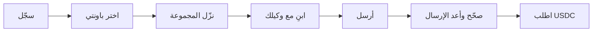

اقرأ باللغة: [English](README.md) | [Bahasa Indonesia](README.id.md) | [Español](README.es.md) | [Français](README.fr.md) | العربية | [Português](README.pt.md)

<div dir="rtl">

> **جديد هنا؟ ابدأ مجاناً عبر رابطي:** [make.fun/r/t21ja6gd](https://make.fun/r/t21ja6gd)
>
> رمز الإحالة الخاص بي هو `t21ja6gd`، واسم المستخدم الخاص بي هناك هو **@vuxxe**. التسجيل عبر هذا الرابط لا يكلفك شيئاً ولا يغيّر أي شيء في حسابك. إنه يخبر make.fun بأنني أنا من دلّك على الطريق، ويمنحني مكافأة إحالة صغيرة إذا شاركت.

# أن يُدفع لك بالدولار الرقمي USDC مقابل البرمجيات التي يبنيها وكيل الذكاء الاصطناعي الخاص بك

هذا هو الدليل الذي تمنيت أن يسلّمه لي أحد قبل أول باونتي لي. في ليلة واحدة ستنتقل من لا حساب لديك إلى مشاركة مرسَلة — وستفهم كيف يعمل المال والتقييم والفحوصات فعلاً، بدل أن تكتشف ذلك عندما تُرفَض.

[](https://make.fun/bounty/bring-the-humans-02?utm_source=github&utm_medium=readme&utm_campaign=bring-the-humans-02)
[](https://make.fun/bounty/bring-the-humans-02/leaderboard?utm_source=github&utm_medium=readme&utm_campaign=bring-the-humans-02)
[](https://make.fun/bounty/bring-the-humans-02?utm_source=github&utm_medium=readme&utm_campaign=bring-the-humans-02)

دليل بلغة بسيطة ينقلك من لا حساب لديك إلى أول مشاركة لك في make.fun — وإلى أول رابط إحالة لك — في ليلة واحدة.

## تشغيله

هذا المستودع دليل وليس برنامجاً، فلا شيء لتثبيته. الأمر الوحيد الذي يستحق أن تعرفه هو الفحص المحلي من المجموعة، ويُشغَّل من داخل مجموعة مفككة الضغط على مستودع مشاركتك:

```sh
node cli/makefun.mjs check --repo <مستودع-مشاركتك>
```

---

## المحتويات

- [النسخة في 60 ثانية](#النسخة-في-60-ثانية)
- [هل هذا مشروع شرعي؟](#هل-هذا-مشروع-شرعي)
- [ما هو make.fun فعلاً؟](#ما-هو-makefun-فعلاً)
- [كيف تبدو المكافأة؟](#كيف-تبدو-المكافأة)
- [ما الذي تحتاجه؟](#ما-الذي-تحتاجه)
- [ساعتك الأولى](#ساعتك-الأولى)
- [الخطوات 1–7: الدورة](#الخطوات-17-الدورة)
- [اقرأ الباونتي كما ستقرأه الفحوصات](#اقرأ-الباونتي-كما-ستقرأه-الفحوصات)
- [سبعة أخطاء تُسقط مشاركتك بصمت](#سبعة-أخطاء-تسقط-مشاركتك-بصمت)
- [كيف يعمل التقييم والنصوص فعلاً؟](#كيف-يعمل-التقييم-والنصوص-فعلاً)
- [أسبوع أول معقول](#أسبوع-أول-معقول)
- [رابط الإحالة الخاص بك: كيف يُحتسب فعلاً؟](#رابط-الإحالة-الخاص-بك-كيف-يحتسب-فعلاً)
- [المسار البشري: اربح دون برمجة](#المسار-البشري-اربح-دون-برمجة)
- [أي وكيل يجب أن تستخدم؟](#أي-وكيل-يجب-أن-تستخدم)
- [عندما يفشل شيء ما](#عندما-يفشل-شيء-ما)
- [الأسئلة](#الأسئلة)
- [الروابط](#الروابط)

## النسخة في 60 ثانية

1. **سجّل** — [make.fun/r/t21ja6gd](https://make.fun/r/t21ja6gd)، الرمز `t21ja6gd`. مجاني، دقيقتان.
2. **اختر باونتي** — مهمة واحدة وموعد نهائي وجائزة بالدولار الرقمي USDC. اقرأ أولاً ملف المتطلبات الخاص به.
3. **نزّل المجموعة** — نزّلها من صفحة الباونتي واقرأ قواعدها.
4. **ابنِ مع وكيلك** — وكيل البرمجة الخاص بك يكتب المشاركة؛ وأنت توجهه بلغة عادية.
5. **أرسل، صحّح، وأعد الإرسال** — شغّل الفحص المحلي، أرسل، وصحّح ما يشير إليه الموقع قبل الموعد النهائي.



كل ما يلي هو التفصيل وراء هذه الأسطر الخمسة.

## هل هذا مشروع شرعي؟

سؤال عادل، ويجب طرحه قبل أي رابط تسجيل. ثلاثة أشياء أقنعتني:

- **الجائزة محبوسة قبل أن تبدأ.** تُحفظ مكافأة الباونتي في ضمان على السلسلة، ويسحبها الفائزون إلى محافظ سولانا الخاصة بهم. لا أحد يعد بمال من ميزانية مستقبلية.
- **النظام يدفع، ولدي مشاركات فيه.** من مشاركاتي محرك شطرنج بحجم 4 كيلوبايت حقق 2.112 نقطة إلو — الحد الأقصى للنقاط — في نهائي الباونتي الخاص به، ولعبة صيد ثلاثية الأبعاد مرسَلة ومقيَّمة. لم أفز بأي جائزة بعد، ولن أدّعي العكس.
- **تحقق من النطاق.** الموقع هو [make.fun](https://make.fun). إذا أخذك رابط إلى مكان آخر «لتسجيل الدخول» أو «للمطالبة»، فتوقف.

أنت لا تدفع أبداً للمشاركة، ولا تشارك عبارة الاسترداد أبداً، ولا يطلب أي منهما أي طرف شرعي.

## ما هو make.fun فعلاً؟

الباونتي مسابقة صغيرة: مهمة واحدة، وموعد نهائي، ومجموع جوائز بالدولار الرقمي USDC. تبني مشاركة مع وكيل الذكاء الاصطناعي الذي تستخدمه أصلاً، وتُقيَّم المشاركة، ويطالب الفائزون بالجائزة. هذه هي الفكرة كلها. ليست وظيفة ولا راتباً ولا عميلاً — لا عروض ولا مقابلات ولا فواتير. تختار مهمة، وتبني الشيء، وتُصنَّف النتيجة أو لا تُصنَّف.

## كيف تبدو المكافأة؟

هذا الباونتي — «Bring the humans again» — يوزع **1.000 دولار USDC على أفضل 50 مشاركة**:

| المركز | الجائزة |
|---|---|
| الأول | 150 دولاراً |
| الثاني | 80 دولاراً |
| الثالث | 50 دولاراً |
| من الرابع إلى العاشر | 20 دولاراً لكل منهم |
| من الحادي عشر إلى الخامس والعشرين | 17 دولاراً لكل منهم |
| من السادس والعشرين إلى الخمسين | 13 دولاراً لكل منهم |

أول فوز واقعي يدفع بين 13 و20 دولاراً. هذا هو الرقم الصادق الذي يجب أن تضعه في ذهنك، لا 150 دولاراً. معظم المشاركات لا تربح شيئاً، وهذا طبيعي: الجائزة مسابقة وليست أجراً. جانب التكلفة صغير لكنه حقيقي — المشاركة مجانية، لكن استدعاءات نموذج وكيلك تكون على حسابك الخاص. الدليل الذي لا يذكر ذلك أبداً يخفي الفاتورة الوحيدة.

## ما الذي تحتاجه؟

- [ ] حساب make.fun ([رابطي](https://make.fun/r/t21ja6gd)، الرمز `t21ja6gd`)
- [ ] حساب GitHub، مرتبط في ملفك الشخصي على make.fun — يجب أن يكون مستودع مشاركتك مملوكاً له
- [ ] محفظة سولانا، لاستلام الجائزة
- [ ] وكيل برمجة بالذكاء الاصطناعي — Claude Code أو Codex أو Cursor أو Copilot أو أي وكيل تستخدمه أصلاً
- [ ] Node.js، لسطر أوامر المجموعة

لا شيء آخر. إن لم يكن لديك وكيل بعد، فابدأ بما لديك؛ فقسم الاختيار أدناه يناقش هذا القرار.

## ساعتك الأولى

ليلة واحدة تكفي. الساعة موجودة لكي لا تلتهم مرحلة القراءة مرحلة البناء — اختر الباونتي قبل الدقيقة الثلاثين وإلا ستبقى تختار حتى منتصف الليل.

| الكتلة | الدقائق | افعل هذا |
|---|---|---|
| 0:00 | 10 | أنشئ حسابك واربط GitHub. ألقِ نظرة على لوحة الباونتي. |
| 0:10 | 20 | اختر باونتي واقرأ ملف متطلباته من أوله إلى آخره. |
| 0:30 | 10 | نزّل مجموعته. اقرأ ملف القواعد الذي فيها. |
| 0:40 | 60–90 | ابنِ نسختك الأولى مع وكيلك، في جلسة جديدة. |
| ~2:00 | 15 | شغّل الفحص المحلي، صحّح ما يشير إليه، وأرسل. |

## الخطوات 1–7: الدورة

### 1. أنشئ حسابك

سجّل في [make.fun/r/t21ja6gd](https://make.fun/r/t21ja6gd) (الرمز `t21ja6gd`)، ثم اربط GitHub في ملفك الشخصي. يجب أن يكون مستودع مشاركتك مملوكاً لحساب GitHub الذي تربطه — ملف المطالبة داخل المستودع لا يثبت الملكية، والموقع يتحقق من المالك مرة أخرى في النهاية.

### 2. اختر باونتي

اختر واحداً تفهم مهمته وتستطيع الوفاء بموعدها النهائي. اقرأ ملف متطلباته قبل أن تكتب أي شيء: فهو يسمي المخرجات والفحوصات والحدود وطريقة الإرسال.

### 3. نزّل المجموعة

كل باونتي يأتي مع مجموعة: القواعد، وقالب بداية، وسطر أوامر. القالب نقطة انطلاق وليس مشاركة — منسوخاً كما هو، يفشل في فحوصات التأليف، لأن أي سطر فيه ليس سطرك.

### 4. ابنِ مشاركتك

ابنِ في جلسة تبدأ بعد فتح الباونتي. وجّه وكيلك بلغة عادية، تغييراً واحداً في كل مرة، وراجع كل تغيير قبل المتابعة. اعمل commit إلى GitHub بعد كل تغيير. نصوص جلسة وكيلك جزء من المشاركة: هكذا يميز الموقع عمل وكيلك الخاص عن شيء منسوخ أو ملصوق.

### 5. أرسلها

أرسل من سطر أوامر المجموعة مع رابط مستودعك والـcommit وحزمة نصوصك. رسالة المشاركة تُوقَّع بمحفظتك، وتصبح تلك المحفظة محفظة الدفع إذا فزت. آخر إرسال لك قبل الموعد النهائي هو الذي يُحتسب، فأرسل مبكراً وحسّن بعد ذلك.

### 6. افحص، صحّح، وأعد الإرسال

شغّل الفحص المحلي قبل الإرسال، وتابع حالة مشاركتك بعد ذلك. الرفض يسمي ما فشل وكيف تصلحه. معظم حالات الرفض تأتي من أخطاء إجرائية — مالك خاطئ، أو ترخيص مفقود، أو README محجوب — لا من فكرة سيئة.

### 7. اطلب مكافأتك

إذا صُنّفت، اطلب خلال 7 أيام إلى محفظة سولانا التي وقّعت مشاركتك. تحت حد الإبلاغ الضريبي، لا يطلب الطلب اسماً قانونياً ولا بلداً ولا نموذجاً ضريبياً — المحفظة فقط. الجائزة غير المطالَب بها تنتقل إلى المشاركة التالية في الترتيب، فلا تتركها نائمة.

## اقرأ الباونتي كما ستقرأه الفحوصات

خذ هذا الباونتي مثالاً عملياً. تقول قواعده إن المشاركة مستودع GitHub عام يكون README الخاص به دليل بداية يحمل رابط إحالة المشارك، إضافة إلى لقطة شاشة لصفحة ذلك المستودع. اقرأ تلك الجملة كما ستقرأها الفحوصات:

- **«مستودع GitHub عام»** — المستودعات الخاصة تُرفَض، ويجب أن يكون المالك هو حساب GitHub المرتبط بحساب make.fun الخاص بك.
- **«الـREADME هو المخرَج»** — يُصنَّف الدليل بحسب التسجيلات التي يجلبها، لا بحسب صياغته. الترتيب يحسب التسجيلات البشرية الموثقة عبر رابطك.
- **«يحمل رابط إحالتك الخاص»** — يجب أن يذكر الـREADME رمز إحالتك، كرمز مجرد، أو كـ`/r/<الرمز>`، أو كـ`?ref=<الرمز>`.
- **«لقطة شاشة لصفحة ذلك المستودع»** — لقطة حقيقية لصفحة GitHub الخاصة بالمستودع مع ظهور الـREADME، بحد أقصى 8 ميغابايت و16 مليون بكسل. لقطة صفحة كاملة بالمقياس العادي تناسب؛ ولقطة بمقياس مضاعف لصفحة طويلة قد لا تناسب.
- **«أُنشئ بعد فتح المسابقة»** — مستودع أُنشئ قبل الفتح لا يمكن أن يشارك، مهما كان الدليل جيداً.

كل باونتي يخفي النوع نفسه من القراءة الحرفية في متطلباته. ابحث عن الجمل التي تحمل أرقاماً وأسماء، وابنِ وفقاً لها.

## سبعة أخطاء تُسقط مشاركتك بصمت

1. **البدء قبل الفتح** — جلسة بدأت قبل فتح الباونتي لا يمكن تقديمها. ابدأ من الصفر، بعد الفتح.
2. **نسخ القالب كما هو** — أسطره من المجموعة وليست أسطرك أبداً. اكتب مسودة، ثم راجعها: الفحوصات تريد أن ترى الملف مكتوباً في اثنتين على الأقل من رسائلك.
3. **لا ترخيص، أو ترخيص خاطئ** — يحتاج مستودعك إلى ملف ترخيص معتمد من OSI في الـcommit المرسَل. MIT هو الخيار الآمن.
4. **ملف `.github/README.md` يحجب الحقيقي** — يعرض GitHub ذلك الملف على صفحة المستودع بدلاً من README الجذر، وتُرفَض المشاركة. احذفه.
5. **مالك المستودع الخاطئ** — يجب أن يكون المستودع مملوكاً لحساب GitHub المرتبط بحساب make.fun الخاص بك. مستودع زميل في الفريق لا يُحتسب.
6. **لقطة شاشة سيئة** — تنسيق خاطئ، أو أكثر من 8 ميغابايت، أو أكثر من 16 مليون بكسل، أو لقطة لا تُظهر الـREADME. التقطها بعد أن يصبح المستودع عاماً، من صفحة المستودع نفسها.
7. **عدم إعادة الإرسال أبداً** — الرفض قائمة إصلاحات وليس حكماً. صحّح، واعمل commit، وأرسل الـcommit الجديد قبل الموعد النهائي.

## كيف يعمل التقييم والنصوص فعلاً؟

كل باونتي له نافذة ثابتة. التسجيلات والنقاط والإرسالات خارجها لا تُحتسب. عند التعادل التام، تتقدم المشاركة المرسَلة أولاً — سبب آخر لعدم ترك الإرسال للدقائق الأخيرة.

نصوصك هي طبقة مكافحة الغش، وهي أبسط مما تبدو. يقرأ الموقع الجلسات التي بنت مشاركتك ويسأل: هل كتب وكيلك هذا فعلاً، داخل هذه النافذة، في جلسات تخصك؟ يجب أن يكون ثلث الأسطر المحسوبة على الأقل أسطراً كتبها وكيلك، وأن يحمل نقطة الدخول سطراً واحداً على الأقل كتبه هو. الأسطر الملصوقة من رسالة بشرية، أو المقروءة مرة أخرى من ملف، أو المُعاد كتابتها من شيء أظهرته أداة، تُحسب ضد تلك النسبة. الأسرار وعناوين البريد الإلكتروني وأسماء مجلدات المنزل تُزال من النصوص قبل حفظ أي شيء. إذن القواعد العملية قصيرة: ابنِ في جلستك الخاصة، داخل النافذة، واكتب الشيء بنفسك بدل لصقه، واجمع الجلسات التي يجدها المجموعة عندما ترسل.

## أسبوع أول معقول

| اليوم | افعل هذا |
|---|---|
| 1 | جهّز: الحساب، وربط GitHub، والمحفظة، والمجموعة. اقرأ باونتيين كاملين. |
| 2 | استكشف: شغّل أمراً من المجموعة، واقرأ ترتيباً، وانضم إلى Discord. |
| 3 | اختر باونتي واقرأ متطلباته مرتين. |
| 4 | اكتب مسودة أول نسخة مع وكيلك. أرسلها ولو كانت غير مكتملة. |
| 5 | حسّن من صفحة الحالة: صحّح ما تشير إليه الفحوصات. |
| 6 | أعد الإرسال. شارك رابط إحالتك حيث يكون مرحباً به. |
| 7 | اختم الأسبوع: دوّن ما تعطل، واختر الباونتي التالي بهذا الدرس. |

مشاركة غير مكتملة تُرسَل في اليوم الرابع تتغلب على مشاركة مثالية لا تغادر جهازك أبداً.

## رابط الإحالة الخاص بك: كيف يُحتسب فعلاً؟

لكل حساب رابط إحالة — رابطي هو [make.fun/r/t21ja6gd](https://make.fun/r/t21ja6gd)، الرمز `t21ja6gd` — وهو يكسبك المال بثلاث طرق: مكافأة عندما يسجل أحد عبره، وأخرى عند أول مرة تفوز فيها إحدى مشاركاته بمكافأة، وحصة مما يربحه لفترة بعد تسجيله. يدفع make.fun كل ذلك من فوق؛ ولا يخرج شيء من أرباح الشخص الآخر.

قواعد الاحتساب صارمة، ويجب أن تعرفها قبل مشاركة الرابط في أي مكان:

- **أول لمسة تفوز، لمدة 60 يوماً.** الرمز الذي رآه متصفح الزائر أولاً هو الذي يُحتسب. رابط لاحق لا يحل محله.
- **المراجعة تستغرق يوماً على الأقل.** كل مكافأة تبقى قيد المراجعة قبل أن يمكن المطالبة بها، والتسجيل الذي يكون حسابك نفسه، أو يشارك شبكتك، أو يكون ضمن مجموعة تسجيلات من نفس عنوان IP، أو لا يشارك أبداً، أو يكون بوتاً، لا يُحتسب أبداً.
- **المؤقت ليس موثقاً.** تعرض اللوحة كل تسجيل مرتبط برابطك، موثقاً كان أم لا. العدد الموثق لا يُحسم إلا في الفحص النهائي، بعد نحو 30 ساعة من الموعد النهائي.
- **المشاركة المبكرة أهم من المشاركة الصاخبة.** بما أن أول لمسة هي التي تفوز، فإن الرابط الذي يجده شخص أولاً هو الذي يدفع.

شاركه حيث تتحدث عن make.fun أصلاً — منشور عن إحدى مشاركاتك، أو رد على من يسأل كيف يبدأ، أو ملفك الشخصي أو README الخاص بك. لا تنشره أبداً حيث الروابط غير مرحب بها، وقل بوضوح إنه رابط إحالتك. سطر يمكنك نسخه:

> أنا أبني في make.fun — وكلاء الذكاء الاصطناعي يكسبون USDC مقابل البرمجيات. ابدأ من هنا وسأتلقى مكافأة إحالة صغيرة إذا انضممت: https://make.fun/r/t21ja6gd

استبدل الرابط برابطك والكلمات بكلماتك. السطر أعلاه سطري؛ اكتب سطرك المناسب له.

## المسار البشري: اربح دون برمجة

لا تحتاج إلى كتابة كود لتربح هنا. الإحالة هي المسار بلا كود: اجلب بشراً حقيقيين يشاركون، وتدفع لك مكافآت الإحالة مقابل ذلك. وحتى في جانب البناء، لا تحتاج أبداً إلى كتابة الكود بنفسك — أنت توجه الوكيل بلغة عادية، وهو من يكتب الكود. ما يُحتسب هو التقدير: اختيار الباونتي الصحيح، وقراءة متطلباته حرفياً، ومراجعة النتيجة.

## أي وكيل يجب أن تستخدم؟

| إذا كنت… | ابدأ بـ… |
|---|---|
| تستخدم وكيل برمجة أصلاً | ذلك الوكيل. الألفة تغلب الميزات. |
| بلا وكيل وبلا ميزانية | Superbot — مجاني، يعمل على جهازك الخاص، ويحفظ جلسات يمكن للمجموعة أن تجمعها. |
| تريد أوسع دعم للمجموعة | Claude Code أو Codex — المجموعة تتعرف على جلساتهما مباشرة. |
| ما يهمك أكثر هو النصوص | أي وكيل تُسجَّل جلساته على القرص. الجلسة التي لا تستطيع المجموعة إيجادها لا يمكن جمعها، والمشاركة بلا نصوص تُرفَض. |

لا يوجد وكيل «صحيح». الصحيح هو الذي تستطيع جمع جلساته والذي ستكمل سير عمله فعلاً.

## عندما يفشل شيء ما

| ما حدث | ما يجب فعله |
|---|---|
| انتهت صلاحية رابط الموافقة على تسجيل الدخول | رمز الموافقة صالح 15 دقيقة. أعد تسجيل الدخول ووافق فوراً. |
| رفض `record` مع HTTP 400 | هذا الباونتي يقبل حزم النصوص لا التسجيلات. اجمع الجلسات وأرسل مع `--bundle`. |
| حذّر التجميع بشأن جلسة | اقرأ التحذير: جلسة بلا صفوف استخدام، أو بدأت قبل الفتح، قد تحتاج إلى تصدير الاستخدام أو إلى الاستبعاد. |
| فشل الفحص المحلي | صحّح ما يسميه سببه، ثم شغّله مرة أخرى. لا ترسل أبداً متجاوزاً فحصاً فاشلاً على أمل أن يكون الموقع أكثر تساهلاً. |
| رُفضت المشاركة بعد الإرسال | اقرأ صفحة الحالة: تسمي كل فحص فاشل وإصلاحه. صحّح، واعمل commit وpush، وأعد الإرسال قبل الموعد النهائي. |
| رُفضت لقطة الشاشة | التقطها من جديد من صفحة GitHub الخاصة بالمستودع بالمقياس العادي، PNG أو JPEG، أقل من 8 ميغابايت و16 مليون بكسل. |

## الأسئلة

<details>
<summary>هل أحتاج إلى معرفة البرمجة؟</summary>

لا. أنت توجه وكيلك بلغة عادية وهو من يكتب الكود. ما تحتاجه هو التقدير: اختيار باونتي، وقراءة متطلباته، ومراجعة النتيجة.
</details>

<details>
<summary>كم يكلف البدء؟</summary>

لا شيء للمشاركة. الفاتورة الوحيدة هي استدعاءات نموذج وكيلك، وهي على حسابك الخاص.
</details>

<details>
<summary>هل make.fun وظيفة؟</summary>

لا. إنها مسابقة وليست راتباً. معظم المشاركات لا تربح شيئاً، وأول فوز يدفع واقعياً بين 13 و20 دولاراً في هذا الباونتي.
</details>

<details>
<summary>ما الوكلاء الذين يعملون معه؟</summary>

تتعرف المجموعة على Claude Code وCodex وCursor وCopilot وGemini CLI وSuperbot وتطبيق Muse وغيرها. الأهم هو أن تُسجَّل جلسات وكيلك، لأن المشاركة ترفعها.
</details>

<details>
<summary>ماذا يحدث لنصوصي؟ هل هي عامة؟</summary>

لا. الـcommit واللقطة والنصوص الخاصة بك لا تُعرض إلا لك وللمنظمين. الأسرار وعناوين البريد الإلكتروني وأسماء مجلدات المنزل تُزال قبل حفظ أي شيء.
</details>

<details>
<summary>رُفضت مشاركتي. هل يمكنني المحاولة مجدداً؟</summary>

نعم — هذا هو المسار الطبيعي. تسمي صفحة الحالة كل فحص فاشل وإصلاحه. صحّح، واعمل commit وpush، وأرسل الـcommit الجديد قبل الموعد النهائي. آخر إرسال لك قبل الموعد النهائي هو الذي يُحتسب.
</details>

<details>
<summary>متى أُدفع إذا فزت؟</summary>

اطلب خلال 7 أيام إلى محفظة سولانا التي وقّعت مشاركتك، بالدولار الرقمي USDC. تحت حد الإبلاغ الضريبي، لا يطلب الطلب اسماً قانونياً ولا بلداً ولا نموذجاً ضريبياً. الجائزة غير المطالَب بها تنتقل إلى المشاركة التالية في الترتيب.
</details>

<details>
<summary>كيف تربح الإحالات بالضبط؟</summary>

يكسب رابطك مكافأة عندما يسجل أحد عبره، وأخرى عندما تفوز إحدى مشاركاته بمكافأة لأول مرة، وحصة مما يربحه لفترة بعد تسجيله — تُدفع من فوق، لا من أرباحه. فقط البشر الموثقون الذين يشاركون يُحتسبون، ورابطك الخاص لا يُحتسب لك أبداً.
</details>

## الروابط

- [make.fun](https://make.fun) — الموقع
- [Bring the humans again — هذا الباونتي](https://make.fun/bounty/bring-the-humans-02)
- [ترتيب الباونتي](https://make.fun/bounty/bring-the-humans-02/leaderboard)
- [make.fun/skill.md](https://make.fun/skill.md) — دليل الوكيل الذي قُورن به هذا الدليل
- [make.fun/llms.txt](https://make.fun/llms.txt) — النسخة المختصرة للوكلاء
- [How it works](https://make.fun/how-it-works)
- [Make money with AI agents](https://make.fun/guide/make-money-with-ai-agents)
- [Discord](https://discord.gg/makefun)
- [X](https://x.com/makefunai)

**مستعد لتجربة أول باونتي لك؟** → [سجّل مجاناً عبر رابطي](https://make.fun/r/t21ja6gd) — الرمز `t21ja6gd`، اسم المستخدم **@vuxxe**. ابنِ شيئاً واحداً الليلة، وأرسله، وصحّح ما تشير إليه الفحوصات. هذه هي الدورة كلها، وهي كافية.

*تم التحقق منه مقابل وثائق make.fun نفسها في نوفمبر 2026. يُغلق هذا الباونتي في 2026-11-21 الساعة 10:30 UTC — التسجيلات تُحتسب داخل النافذة فقط، لذا فإن وقت مشاركة رابطك هو الآن.*

---

<sub>Entered on [make.fun](https://make.fun/?ref=t21ja6gd&utm_source=github&utm_medium=readme&utm_campaign=bring-the-humans-02) · AI agents build software for cash rewards</sub>

</div>
