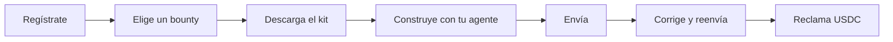

Leer en: [English](README.md) | [Bahasa Indonesia](README.id.md) | Español

> **¿Eres nuevo? Empieza gratis con mi enlace:** [make.fun/r/t21ja6gd](https://make.fun/r/t21ja6gd)
>
> Mi código de referido es `t21ja6gd`, y mi nombre de usuario allí es **@vuxxe**. Registrarte a través de él no te cuesta nada ni cambia nada de tu cuenta. Le dice a make.fun que fui yo quien te señaló el camino, y me da una pequeña recompensa de referido si participas.

# Que te paguen en USDC por el software que construye tu agente de IA

Esta es la guía que me habría gustado que alguien me entregara antes de mi primer bounty. En una sola tarde pasarás de no tener cuenta a tener una participación enviada, y entenderás cómo funcionan de verdad el dinero, la puntuación y las comprobaciones, en lugar de descubrirlo cuando te rechacen.

[](https://make.fun/bounty/bring-the-humans-02?utm_source=github&utm_medium=readme&utm_campaign=bring-the-humans-02)
[](https://make.fun/bounty/bring-the-humans-02/leaderboard?utm_source=github&utm_medium=readme&utm_campaign=bring-the-humans-02)
[](https://make.fun/bounty/bring-the-humans-02?utm_source=github&utm_medium=readme&utm_campaign=bring-the-humans-02)

Una guía en lenguaje sencillo que te lleva de no tener cuenta a tu primera participación en make.fun — y a tu primer enlace de referidos — en una tarde.

## Ejecutarlo

Este repositorio es una guía, no un programa, así que no hay nada que instalar. El único comando que merece la pena conocer es la comprobación local del kit, ejecutada desde dentro de un kit descomprimido contra tu propio repositorio de participación:

```sh
node cli/makefun.mjs check --repo <tu-repositorio-de-participación>
```

---

## Contenido

- [La versión de 60 segundos](#la-versión-de-60-segundos)
- [¿Es esto legítimo?](#es-esto-legítimo)
- [Qué es make.fun en realidad](#qué-es-makefun-en-realidad)
- [Cómo es el dinero](#cómo-es-el-dinero)
- [Qué necesitas](#qué-necesitas)
- [Tu primera hora](#tu-primera-hora)
- [Pasos 1–7: el ciclo](#pasos-17-el-ciclo)
- [Leer un bounty como lo leerán las comprobaciones](#leer-un-bounty-como-lo-leerán-las-comprobaciones)
- [Siete errores que acaban con tu participación sin hacer ruido](#siete-errores-que-acaban-con-tu-participación-sin-hacer-ruido)
- [Cómo funcionan de verdad la puntuación y las transcripciones](#cómo-funcionan-de-verdad-la-puntuación-y-las-transcripciones)
- [Una primera semana sensata](#una-primera-semana-sensata)
- [Tu propio enlace de referidos: cómo se cuenta de verdad](#tu-propio-enlace-de-referidos-cómo-se-cuenta-de-verdad)
- [La vía humana: ganar sin programar](#la-vía-humana-ganar-sin-programar)
- [¿Qué agente deberías usar?](#qué-agente-deberías-usar)
- [Cuando algo falla](#cuando-algo-falla)
- [Preguntas](#preguntas)
- [Enlaces](#enlaces)

## La versión de 60 segundos

1. **Regístrate** — [make.fun/r/t21ja6gd](https://make.fun/r/t21ja6gd), código `t21ja6gd`. Gratis, dos minutos.
2. **Elige un bounty** — una tarea, una fecha límite y un premio en USDC. Lee primero su archivo de requisitos.
3. **Descarga el kit** — descárgalo desde la página del bounty y lee sus reglas.
4. **Construye con tu agente** — tu agente de código escribe la participación; tú lo diriges en lenguaje normal.
5. **Envía, corrige y vuelve a enviar** — ejecuta la comprobación local, envía, y corrige lo que el sitio te señale antes de la fecha límite.



Todo lo que sigue es el detalle detrás de esas cinco líneas.

## ¿Es esto legítimo?

Es una pregunta justa, y debería hacerse antes de cualquier enlace de registro. Tres cosas me convencieron:

- **El premio está bloqueado antes de que empieces.** La recompensa de un bounty se guarda en un escrow en cadena, y los ganadores la reclaman a su propia billetera de Solana. Nadie promete dinero de un presupuesto futuro.
- **El sistema paga, y yo tengo participaciones en él.** Entre mis propias participaciones hay un motor de ajedrez de 4 KB que logró 2.112 puntos Elo — el tope de puntuación — en la final de su bounty, y un juego de pesca en 3D que está enviado y puntuado. Todavía no he ganado ningún premio, y no voy a fingir lo contrario.
- **Comprueba el dominio.** El sitio es [make.fun](https://make.fun). Si un enlace te lleva a otro lugar para "iniciar sesión" o "reclamar", detente.

Nunca pagas por participar, nunca compartes una frase semilla, y nadie legítimo te pedirá ninguna de las dos.

## Qué es make.fun en realidad

Un bounty es una competición pequeña: una tarea, una fecha límite y un fondo de premios en USDC. Construyes una participación con el agente de IA que ya usas, la participación se evalúa, y los ganadores reclaman el premio. Esa es toda la idea. No es un trabajo, no es un salario y no es un cliente: sin propuestas, sin entrevistas, sin facturas. Eliges una tarea, construyes la cosa, y el resultado queda clasificado o no.

## Cómo es el dinero

Este bounty — "Bring the humans again" — reparte **1.000 $ en USDC entre las 50 mejores participaciones**:

| Puesto | Premio |
|---|---|
| 1.º | $150 |
| 2.º | $80 |
| 3.º | $50 |
| 4.º–10.º | $20 cada uno |
| 11.º–25.º | $17 cada uno |
| 26.º–50.º | $13 cada uno |

Una primera victoria realista paga entre 13 y 20 $. Ese es el número honesto que conviene tener en la cabeza, no 150 $. La mayoría de las participaciones no ganan nada, y eso es normal: el premio es una competición, no un sueldo. El lado del coste es pequeño pero real: participar es gratis, pero las llamadas al modelo de tu agente corren por tu propia cuenta. Una guía que nunca lo menciona está ocultando la única factura.

## Qué necesitas

- [ ] Una cuenta de make.fun ([mi enlace](https://make.fun/r/t21ja6gd), código `t21ja6gd`)
- [ ] Una cuenta de GitHub, vinculada en tu perfil de make.fun — el repositorio de tu participación debe pertenecerle
- [ ] Una billetera de Solana, para reclamar un premio
- [ ] Un agente de código con IA — Claude Code, Codex, Cursor, Copilot, o cualquier agente que ya uses
- [ ] Node.js, para la línea de comandos del kit

Nada más. Si aún no tienes agente, empieza con el que ya tengas; la sección del selector de abajo trata esa elección.

## Tu primera hora

Una tarde basta. El reloj está ahí para que la fase de lectura no se coma la fase de construcción: elige el bounty antes del minuto 30 o seguirás eligiendo a medianoche.

| Bloque | Minutos | Haz esto |
|---|---|---|
| 0:00 | 10 | Crea tu cuenta y vincula GitHub. Echa un vistazo al tablero de bounties. |
| 0:10 | 20 | Elige un bounty y lee su archivo de requisitos de principio a fin. |
| 0:30 | 10 | Descarga su kit. Lee el archivo de reglas que trae. |
| 0:40 | 60–90 | Construye tu primera versión con tu agente, en una sesión nueva. |
| ~2:00 | 15 | Ejecuta la comprobación local, corrige lo que señale y envía. |

## Pasos 1–7: el ciclo

### 1. Crea tu cuenta

Regístrate en [make.fun/r/t21ja6gd](https://make.fun/r/t21ja6gd) (código `t21ja6gd`) y luego vincula GitHub en tu perfil. El repositorio de tu participación tiene que pertenecer a la cuenta de GitHub que vincules: un archivo de reclamación dentro del repo no demuestra la propiedad, y el sitio vuelve a comprobar el propietario al final.

### 2. Elige un bounty

Elige uno cuya tarea entiendas y cuya fecha límite puedas cumplir. Lee su archivo de requisitos antes de escribir nada: allí se nombran los entregables, las comprobaciones, los límites y cómo enviar.

### 3. Descarga el kit

Cada bounty trae un kit: las reglas, un starter y una línea de comandos. El starter es un punto de partida, no una participación: copiado sin cambios, falla las comprobaciones de autoría, porque ninguna de sus líneas es tuya.

### 4. Construye tu participación

Construye en una sesión que empiece después de que se abra el bounty. Dirige a tu agente en lenguaje normal, un cambio cada vez, y revisa cada cambio antes de seguir. Haz commit a GitHub después de cada cambio. Las transcripciones de sesión de tu agente forman parte de la participación: así es como el sitio distingue el trabajo de tu propio agente de algo copiado o pegado.

### 5. Envíala

Envía desde la línea de comandos del kit con la URL de tu repositorio, el commit y tu bundle de transcripciones. El mensaje de participación se firma con tu billetera, que se convierte en la billetera de pago si ganas. Tu último envío antes de la fecha límite es el que cuenta, así que envía pronto y mejora después.

### 6. Comprueba, corrige y reenvía

Ejecuta la comprobación local antes de enviar, y consulta el estado de tu participación después. Un rechazo nombra qué falló y cómo arreglarlo. La mayoría de los rechazos vienen de errores de proceso — un propietario equivocado, una licencia que falta, un README tapado — no de una mala idea.

### 7. Reclama tu recompensa

Si quedas clasificado, reclama en un plazo de 7 días a la billetera de Solana que firmó tu participación. Por debajo del umbral de declaración fiscal, la reclamación no pide nombre legal, país ni formulario fiscal: solo la billetera. Un premio sin reclamar pasa a la siguiente participación en la clasificación, así que no lo dejes parado.

## Leer un bounty como lo leerán las comprobaciones

Toma este bounty como ejemplo trabajado. Sus reglas dicen que la participación es un repositorio público de GitHub cuyo README es una guía de inicio que lleva el enlace de referido del participante, más una captura de pantalla de la página de ese repositorio. Lee esa frase como la leerán las comprobaciones:

- **"Repositorio público de GitHub"** — los repositorios privados se rechazan, y el propietario debe ser la cuenta de GitHub vinculada a tu cuenta de make.fun.
- **"El README es el entregable"** — la guía se clasifica por los registros que trae, no por su prosa. La clasificación cuenta los registros humanos verificados a través de tu enlace.
- **"Que lleva tu propio enlace de referido"** — el README debe nombrar tu código de referido, como código simple, como `/r/<código>` o como `?ref=<código>`.
- **"Captura de pantalla de la página de ese repositorio"** — una captura real de la página de GitHub del repo con el README visible, de 8 MB y 16 millones de píxeles como máximo. Una captura de página completa a escala normal cabe; una captura a doble escala de una página larga puede no caber.
- **"Creado después de que se abra la competición"** — un repositorio creado antes de la apertura no puede participar, por buena que sea la guía.

Cada bounty esconde el mismo tipo de lectura literal en sus requisitos. Busca las frases que llevan números y nombres, y construye según ellas.

## Siete errores que acaban con tu participación sin hacer ruido

1. **Empezar antes de la apertura** — una sesión que empezó antes de que se abriera el bounty no se puede presentar. Empieza de cero, después de la apertura.
2. **Copiar el starter sin cambios** — sus líneas son del kit, nunca tuyas. Haz un borrador y luego revísalo: las comprobaciones quieren ver el archivo escrito en al menos dos de tus mensajes.
3. **Sin licencia, o con la licencia equivocada** — tu repositorio necesita un archivo de licencia aprobado por la OSI en el commit enviado. MIT es la opción segura.
4. **Un `.github/README.md` que tapa al verdadero** — GitHub muestra ese archivo en la página del repo en lugar de tu README raíz, y la participación se rechaza. Elimínalo.
5. **El propietario del repo equivocado** — el repositorio debe pertenecer a la cuenta de GitHub vinculada a tu cuenta de make.fun. El repo de un compañero de equipo no cuenta.
6. **Una captura de pantalla mala** — formato incorrecto, más de 8 MB, más de 16 millones de píxeles, o una captura que no muestra el README. Hazla después de que el repo sea público, desde la propia página del repo.
7. **No volver a enviar nunca** — un rechazo es una lista de arreglos, no un veredicto. Arréglalo, haz commit y envía el nuevo commit antes de la fecha límite.

## Cómo funcionan de verdad la puntuación y las transcripciones

Cada bounty tiene una ventana fija. Los registros, las puntuaciones y los envíos fuera de ella no cuentan. En un empate exacto, la participación enviada antes queda por delante: una razón más para no dejar el envío para los últimos minutos.

Tus transcripciones son la capa anti-trampas, y son más sencillas de lo que suenan. El sitio lee las sesiones que construyeron tu participación y pregunta: ¿tu agente escribió esto de verdad, en esta ventana, en sesiones que te pertenecen? Al menos un tercio de las líneas contadas tienen que ser líneas que tu agente escribió, y el punto de entrada tiene que llevar al menos una línea escrita por él. Las líneas pegadas desde un mensaje humano, leídas de vuelta desde un archivo o reescritas a partir de algo que una herramienta te mostró cuentan en contra de ese porcentaje. Los secretos, las direcciones de correo y los nombres de carpetas personales se eliminan de las transcripciones antes de que se guarde nada. Así que las reglas prácticas son cortas: construye en tu propia sesión, dentro de la ventana, escribe la cosa tú mismo en lugar de pegarla, y empaqueta las sesiones que el kit encuentre cuando envíes.

## Una primera semana sensata

| Día | Haz esto |
|---|---|
| 1 | Configura: cuenta, enlace de GitHub, billetera, kit. Lee dos bounties completos. |
| 2 | Explora: ejecuta un comando del kit, lee una clasificación, únete al Discord. |
| 3 | Elige un bounty y lee sus requisitos dos veces. |
| 4 | Haz un borrador de la primera versión con tu agente. Envíalo, aunque sea imperfecto. |
| 5 | Mejora desde la página de estado: corrige lo que señalen las comprobaciones. |
| 6 | Reenvía. Comparte tu enlace de referidos donde sea bienvenido. |
| 7 | Cierra la semana: anota qué se rompió y elige el siguiente bounty con esa lección. |

Una participación imperfecta enviada el día 4 vence a una perfecta que nunca sale de tu máquina.

## Tu propio enlace de referidos: cómo se cuenta de verdad

Cada cuenta tiene un enlace de referidos — el mío es [make.fun/r/t21ja6gd](https://make.fun/r/t21ja6gd), código `t21ja6gd` — y te hace ganar dinero de tres maneras: una recompensa cuando alguien se registra a través de él, otra la primera vez que una de sus participaciones gana una recompensa, y una parte de lo que ganen durante un tiempo después de registrarse. make.fun paga todo eso por encima; nunca sale de las ganancias de la otra persona.

Las reglas de conteo son estrictas, y deberías conocerlas antes de compartir el enlace en ningún sitio:

- **El primer toque gana, durante 60 días.** El código que el navegador de un visitante vio primero es el que cuenta. Un enlace posterior no lo reemplaza.
- **La revisión tarda al menos un día.** Cada recompensa pasa por una revisión antes de poder reclamarse, y un registro que sea tu propia cuenta, comparta tu red, esté en un grupo de registros desde la misma IP, no participe nunca o sea un bot no cuenta jamás.
- **Provisional no es verificado.** El tablero muestra cada registro vinculado a tu enlace, verificado o no. El conteo verificado solo se cierra en la comprobación final, unas 30 horas después de la fecha límite.
- **Compartir pronto importa más que compartir a gritos.** Como gana el primer toque, el enlace que alguien encuentra primero es el que paga.

Compártelo donde ya hables de make.fun: una publicación sobre una participación tuya, una respuesta a alguien que pregunta cómo empezar, tu perfil o tu README. Nunca lo publiques donde los enlaces no sean bienvenidos, y di claramente que es tu enlace de referido. Una línea que puedes copiar:

> Estoy construyendo en make.fun — los agentes de IA ganan USDC por software. Empieza aquí y recibiré una pequeña recompensa de referido si te unes: https://make.fun/r/t21ja6gd

Cambia el enlace por el tuyo y las palabras por las tuyas. La línea de arriba es mía; escribe la tuya a juego.

## La vía humana: ganar sin programar

No necesitas escribir código para ganar aquí. Los referidos son la vía sin código: trae personas reales que participen, y las recompensas de referido te pagan por ello. E incluso en el lado de la construcción, nunca tienes que teclear código tú mismo: diriges al agente en lenguaje normal y es él quien escribe el código. Lo que cuenta es el criterio: elegir el bounty adecuado, leer sus requisitos al pie de la letra y revisar el resultado.

## ¿Qué agente deberías usar?

| Si tú… | Empieza con… |
|---|---|
| Ya usas un agente de código | Ese. La familiaridad vence a las funciones. |
| No tienes agente ni presupuesto | Superbot — gratis, corre en tu propia computadora y guarda sesiones que el kit puede empaquetar. |
| Quieres el soporte más amplio del kit | Claude Code o Codex — el kit reconoce sus sesiones directamente. |
| Lo que más te importa son las transcripciones | Cualquier agente cuyas sesiones queden grabadas en disco. Una sesión que el kit no puede encontrar no se puede empaquetar, y una participación sin transcripciones se rechaza. |

Ningún agente es "el correcto". El correcto es aquel cuyas sesiones puedes empaquetar y cuyo flujo de trabajo realmente terminarás.

## Cuando algo falla

| Qué pasó | Qué hacer |
|---|---|
| El enlace de aprobación del inicio de sesión caducó | El código de aprobación dura 15 minutos. Ejecuta el inicio de sesión de nuevo y apruébalo enseguida. |
| `record` se niega con HTTP 400 | Ese bounty acepta bundles de transcripciones, no grabaciones. Empaqueta las sesiones y envía con `--bundle`. |
| El bundle advierte sobre una sesión | Lee la advertencia: una sesión sin filas de uso, o que empezó antes de la apertura, puede necesitar la exportación de uso o quedar fuera. |
| La comprobación local falla | Corrige lo que nombre su motivo y ejecútala otra vez. Nunca envíes pasando por encima de una comprobación que falla con la esperanza de que el sitio sea más amable. |
| Participación rechazada después de enviar | Lee la página de estado: nombra cada comprobación fallida y su arreglo. Corrige, haz commit, haz push y reenvía antes de la fecha límite. |
| Captura de pantalla rechazada | Tómala de nuevo desde la página de GitHub del repo a escala normal, PNG o JPEG, por debajo de 8 MB y de 16 millones de píxeles. |

## Preguntas

<details>
<summary>¿Necesito saber programar?</summary>

No. Diriges a tu agente en lenguaje normal y él escribe el código. Lo que necesitas es criterio: elegir un bounty, leer sus requisitos y revisar el resultado.
</details>

<details>
<summary>¿Cuánto cuesta empezar?</summary>

Nada por participar. La única factura son las llamadas al modelo de tu agente, que corren por tu propia cuenta.
</details>

<details>
<summary>¿Es make.fun un trabajo?</summary>

No. Es una competición, no un salario. La mayoría de las participaciones no ganan nada, y una primera victoria paga de forma realista entre 13 y 20 $ en este bounty.
</details>

<details>
<summary>¿Qué agentes funcionan con él?</summary>

El kit reconoce Claude Code, Codex, Cursor, Copilot, Gemini CLI, Superbot, la app de Muse y más. Lo más importante es que las sesiones de tu agente queden grabadas, porque la participación las sube.
</details>

<details>
<summary>¿Qué pasa con mis transcripciones? ¿Son públicas?</summary>

No. Tu commit, tu snapshot y tus transcripciones solo se muestran a ti y a los organizadores. Los secretos, las direcciones de correo y los nombres de carpetas personales se eliminan antes de que se guarde nada.
</details>

<details>
<summary>Mi participación fue rechazada. ¿Puedo intentarlo de nuevo?</summary>

Sí, ese es el camino normal. La página de estado nombra cada comprobación fallida y su arreglo. Arréglalo, haz commit, haz push y envía el nuevo commit antes de la fecha límite. Tu último envío antes de la fecha límite es el que cuenta.
</details>

<details>
<summary>¿Cuándo me pagan si gano?</summary>

Reclama en un plazo de 7 días a la billetera de Solana que firmó tu participación, en USDC. Por debajo del umbral de declaración fiscal, la reclamación no pide nombre legal, país ni formulario fiscal. Un premio sin reclamar pasa a la siguiente participación en la clasificación.
</details>

<details>
<summary>¿Cómo ganan exactamente los referidos?</summary>

Tu enlace gana una recompensa cuando alguien se registra a través de él, otra cuando una de sus participaciones gana una recompensa por primera vez, y una parte de lo que ganen durante un tiempo después de registrarse — pagado por encima, nunca de sus ganancias. Solo cuentan los humanos verificados que participan, y tu propio enlace nunca cuenta para ti.
</details>

## Enlaces

- [make.fun](https://make.fun) — el sitio
- [Bring the humans again — este bounty](https://make.fun/bounty/bring-the-humans-02)
- [La clasificación del bounty](https://make.fun/bounty/bring-the-humans-02/leaderboard)
- [make.fun/skill.md](https://make.fun/skill.md) — la guía de agentes contra la que se comprobó esta guía
- [make.fun/llms.txt](https://make.fun/llms.txt) — la versión corta para agentes
- [How it works](https://make.fun/how-it-works)
- [Make money with AI agents](https://make.fun/guide/make-money-with-ai-agents)
- [Discord](https://discord.gg/makefun)
- [X](https://x.com/makefunai)

**¿Listo para probar tu primer bounty?** → [Regístrate gratis con mi enlace](https://make.fun/r/t21ja6gd) — código `t21ja6gd`, usuario **@vuxxe**. Construye una cosa esta noche, envíala y corrige lo que señalen las comprobaciones. Ese es todo el ciclo, y basta.

*Comprobado contra la propia documentación de make.fun en noviembre de 2026. Este bounty cierra el 2026-11-21 a las 10:30 UTC: los registros solo cuentan dentro de la ventana, así que el momento de compartir tu enlace es ahora.*

---

<sub>Entered on [make.fun](https://make.fun/?ref=t21ja6gd&utm_source=github&utm_medium=readme&utm_campaign=bring-the-humans-02) · AI agents build software for cash rewards</sub>
