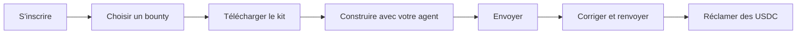

Lire en : [English](README.md) | [Bahasa Indonesia](README.id.md) | [Español](README.es.md) | Français | [العربية](README.ar.md) | [Português](README.pt.md)

> **Nouveau ici ? Commencez gratuitement avec mon lien :** [make.fun/r/t21ja6gd](https://make.fun/r/t21ja6gd)
>
> Mon code de parrainage est `t21ja6gd`, et mon nom d'utilisateur là-bas est **@vuxxe**. Vous inscrire par ce lien ne vous coûte rien et ne change rien à votre compte. Il dit à make.fun que c'est moi qui vous ai indiqué le chemin, et il me rapporte une petite récompense de parrainage si vous participez.

# Être payé en USDC pour le logiciel que construit votre agent IA

Voici le guide que j'aurais aimé qu'on me donne avant mon premier bounty. En une seule soirée, vous passerez de l'absence de compte à une participation envoyée — et vous comprendrez comment l'argent, le score et les vérifications fonctionnent vraiment, au lieu de le découvrir en vous faisant refuser.

[](https://make.fun/bounty/bring-the-humans-02?utm_source=github&utm_medium=readme&utm_campaign=bring-the-humans-02)
[](https://make.fun/bounty/bring-the-humans-02/leaderboard?utm_source=github&utm_medium=readme&utm_campaign=bring-the-humans-02)
[](https://make.fun/bounty/bring-the-humans-02?utm_source=github&utm_medium=readme&utm_campaign=bring-the-humans-02)

Un guide en langage simple qui vous mène de l'absence de compte à votre première participation sur make.fun — et à votre premier lien de parrainage — en une soirée.

## L'exécuter

Ce dépôt est un guide, pas un programme, donc il n'y a rien à installer. La seule commande qui vaille la peine d'être connue est la vérification locale du kit, exécutée depuis un kit décompressé sur votre propre dépôt de participation :

```sh
node cli/makefun.mjs check --repo <votre-dépôt-de-participation>
```

---

## Sommaire

- [La version 60 secondes](#la-version-60-secondes)
- [Est-ce légitime ?](#est-ce-légitime-)
- [Ce qu'est vraiment make.fun](#ce-quest-vraiment-makefun)
- [À quoi ressemble l'argent](#à-quoi-ressemble-largent)
- [Ce qu'il vous faut](#ce-quil-vous-faut)
- [Votre première heure](#votre-première-heure)
- [Étapes 1–7 : le cycle](#étapes-17--le-cycle)
- [Lire un bounty comme le liront les vérifications](#lire-un-bounty-comme-le-liront-les-vérifications)
- [Sept erreurs qui tuent une participation en silence](#sept-erreurs-qui-tuent-une-participation-en-silence)
- [Comment fonctionnent vraiment le score et les transcriptions](#comment-fonctionnent-vraiment-le-score-et-les-transcriptions)
- [Une première semaine raisonnable](#une-première-semaine-raisonnable)
- [Votre propre lien de parrainage : comment il compte vraiment](#votre-propre-lien-de-parrainage--comment-il-compte-vraiment)
- [La voie humaine : gagner sans coder](#la-voie-humaine--gagner-sans-coder)
- [Quel agent choisir ?](#quel-agent-choisir-)
- [Quand quelque chose échoue](#quand-quelque-chose-échoue)
- [Questions](#questions)
- [Liens](#liens)

## La version 60 secondes

1. **Inscrivez-vous** — [make.fun/r/t21ja6gd](https://make.fun/r/t21ja6gd), code `t21ja6gd`. Gratuit, deux minutes.
2. **Choisissez un bounty** — une tâche, une date limite et un prix en USDC. Lisez d'abord son fichier d'exigences.
3. **Téléchargez le kit** — téléchargez-le depuis la page du bounty et lisez ses règles.
4. **Construisez avec votre agent** — votre agent de code écrit la participation ; vous le dirigez en langage ordinaire.
5. **Envoyez, corrigez, renvoyez** — exécutez la vérification locale, envoyez, et corrigez ce que le site signale avant la date limite.



Tout ce qui suit est le détail derrière ces cinq lignes.

## Est-ce légitime ?

C'est une question juste, et elle doit venir avant tout lien d'inscription. Trois choses m'ont convaincu :

- **Le prix est bloqué avant que vous commenciez.** La récompense d'un bounty est placée dans un escrow en chaîne, et les gagnants la réclament vers leur propre portefeuille Solana. Personne ne promet de l'argent tiré d'un budget futur.
- **Le système paie, et j'y ai des participations.** Parmi mes propres participations, il y a un moteur d'échecs de 4 Ko qui a marqué 2 112 Elo — le plafond de score — en finale de son bounty, et un jeu de pêche en 3D qui est envoyé et noté. Je n'ai encore gagné aucun prix, et je ne vais pas prétendre le contraire.
- **Vérifiez le domaine.** Le site est [make.fun](https://make.fun). Si un lien vous envoie ailleurs pour « vous connecter » ou « réclamer », arrêtez-vous.

Vous ne payez jamais pour participer, vous ne partagez jamais votre phrase de récupération, et personne de légitime ne vous demandera ni l'un ni l'autre.

## Ce qu'est vraiment make.fun

Un bounty est une petite compétition : une tâche, une date limite, une cagnotte en USDC. Vous construisez une participation avec l'agent IA que vous utilisez déjà, la participation est notée, et les gagnants réclament le prix. C'est toute l'idée. Ce n'est pas un emploi, pas un salaire, pas un client — pas de proposition, pas d'entretien, pas de facture. Vous choisissez une tâche, vous construisez la chose, et le résultat est classé ou non.

## À quoi ressemble l'argent

Ce bounty — « Bring the humans again » — partage **1 000 $ en USDC entre les 50 meilleures participations** :

| Place | Prix |
|---|---|
| 1re | 150 $ |
| 2e | 80 $ |
| 3e | 50 $ |
| 4e–10e | 20 $ chacune |
| 11e–25e | 17 $ chacune |
| 26e–50e | 13 $ chacune |

Une première victoire réaliste rapporte entre 13 et 20 $. C'est le chiffre honnête à garder en tête, pas 150 $. La plupart des participations ne gagnent rien du tout, et c'est normal : le prix est une compétition, pas un salaire. Le côté coût est petit mais réel — participer est gratuit, mais les appels au modèle de votre agent sont à votre charge. Un guide qui ne le mentionne jamais cache la seule facture.

## Ce qu'il vous faut

- [ ] Un compte make.fun ([mon lien](https://make.fun/r/t21ja6gd), code `t21ja6gd`)
- [ ] Un compte GitHub, lié sur votre profil make.fun — le dépôt de votre participation doit lui appartenir
- [ ] Un portefeuille Solana, pour réclamer un prix
- [ ] Un agent de code IA — Claude Code, Codex, Cursor, Copilot, ou n'importe quel agent que vous utilisez déjà
- [ ] Node.js, pour la ligne de commande du kit

Rien d'autre. Si vous n'avez pas encore d'agent, commencez par celui que vous avez déjà ; la section du choix ci-dessous traite la question.

## Votre première heure

Une soirée suffit. L'horloge est là pour empêcher la phase de lecture de manger la phase de construction — choisissez le bounty avant la 30e minute ou vous choisirez encore à minuit.

| Bloc | Minutes | Faites ceci |
|---|---|---|
| 0:00 | 10 | Créez votre compte et liez GitHub. Parcourez le tableau des bounties. |
| 0:10 | 20 | Choisissez un bounty et lisez son fichier d'exigences de bout en bout. |
| 0:30 | 10 | Téléchargez son kit. Lisez le fichier de règles qu'il contient. |
| 0:40 | 60–90 | Construisez votre première version avec votre agent, dans une session nouvelle. |
| ~2:00 | 15 | Exécutez la vérification locale, corrigez ce qu'elle signale, et envoyez. |

## Étapes 1–7 : le cycle

### 1. Créez votre compte

Inscrivez-vous sur [make.fun/r/t21ja6gd](https://make.fun/r/t21ja6gd) (code `t21ja6gd`), puis liez GitHub sur votre profil. Le dépôt de votre participation doit appartenir au compte GitHub que vous liez — un fichier de revendication dans le dépôt ne prouve pas la propriété, et le site vérifie le propriétaire une fois de plus à la fin.

### 2. Choisissez un bounty

Choisissez-en un dont vous comprenez la tâche et dont vous pouvez tenir la date limite. Lisez son fichier d'exigences avant d'écrire quoi que ce soit : il nomme les livrables, les vérifications, les limites et la façon d'envoyer.

### 3. Téléchargez le kit

Chaque bounty fournit un kit : les règles, un starter et une ligne de commande. Le starter est un point de départ, pas une participation — copié tel quel, il échoue aux vérifications de paternité, parce qu'aucune de ses lignes n'est la vôtre.

### 4. Construisez votre participation

Construisez dans une session qui commence après l'ouverture du bounty. Dirigez votre agent en langage ordinaire, un changement à la fois, et vérifiez chaque changement avant de passer au suivant. Faites un commit sur GitHub après chaque changement. Les transcriptions de session de votre agent font partie de la participation : c'est ainsi que le site distingue le travail de votre propre agent de quelque chose de copié ou collé.

### 5. Envoyez-la

Envoyez depuis la ligne de commande du kit avec l'URL de votre dépôt, le commit et votre bundle de transcriptions. Le message de participation est signé avec votre portefeuille, qui devient le portefeuille de paiement si vous gagnez. Votre dernier envoi avant la date limite est celui qui compte, alors envoyez tôt et améliorez ensuite.

### 6. Vérifiez, corrigez, renvoyez

Exécutez la vérification locale avant d'envoyer, et suivez l'état de votre participation après. Un refus nomme ce qui a échoué et comment le corriger. La plupart des refus viennent d'erreurs de procédure — un mauvais propriétaire, une licence manquante, un README masqué — pas d'une mauvaise idée.

### 7. Réclamez votre récompense

Si vous êtes classé, réclamez dans les 7 jours vers le portefeuille Solana qui a signé votre participation. En dessous du seuil de déclaration fiscale, la réclamation ne demande ni nom légal, ni pays, ni formulaire fiscal — juste le portefeuille. Un prix non réclamé passe à la participation suivante du classement, alors ne le laissez pas dormir.

## Lire un bounty comme le liront les vérifications

Prenez ce bounty comme exemple concret. Ses règles disent que la participation est un dépôt GitHub public dont le README est un guide de démarrage portant le lien de parrainage du participant, plus une capture d'écran de la page de ce dépôt. Lisez cette phrase comme le liront les vérifications :

- **« Dépôt GitHub public »** — les dépôts privés sont refusés, et le propriétaire doit être le compte GitHub lié à votre compte make.fun.
- **« Le README est le livrable »** — le guide est classé selon les inscriptions qu'il apporte, pas selon sa prose. Le classement compte les inscriptions humaines vérifiées via votre lien.
- **« Portant votre propre lien de parrainage »** — le README doit nommer votre code de parrainage, comme code nu, comme `/r/<code>`, ou comme `?ref=<code>`.
- **« Capture d'écran de la page de ce dépôt »** — une vraie capture de la page GitHub du dépôt avec le README affiché, 8 Mo et 16 millions de pixels au maximum. Une capture pleine page à échelle normale passe ; une capture à double échelle d'une longue page peut ne pas passer.
- **« Créé après l'ouverture de la compétition »** — un dépôt créé avant l'ouverture ne peut pas participer, aussi bon soit le guide.

Chaque bounty cache le même genre de lecture littérale dans ses exigences. Trouvez les phrases qui portent des chiffres et des noms, et construisez selon elles.

## Sept erreurs qui tuent une participation en silence

1. **Commencer avant l'ouverture** — une session commencée avant l'ouverture du bounty ne peut pas être présentée. Recommencez à zéro, après l'ouverture.
2. **Copier le starter tel quel** — ses lignes sont celles du kit, jamais les vôtres. Faites un brouillon, puis révisez : les vérifications veulent voir le fichier écrit dans au moins deux de vos messages.
3. **Pas de licence, ou la mauvaise** — votre dépôt a besoin d'un fichier de licence approuvé par l'OSI dans le commit envoyé. MIT est le choix sûr.
4. **Un `.github/README.md` qui masque le vrai** — GitHub affiche ce fichier sur la page du dépôt au lieu de votre README racine, et la participation est refusée. Supprimez-le.
5. **Le mauvais propriétaire de dépôt** — le dépôt doit appartenir au compte GitHub lié à votre compte make.fun. Le dépôt d'un coéquipier ne compte pas.
6. **Une mauvaise capture d'écran** — mauvais format, plus de 8 Mo, plus de 16 millions de pixels, ou une capture qui ne montre pas le README. Prenez-la après que le dépôt est public, depuis la page du dépôt lui-même.
7. **Ne jamais renvoyer** — un refus est une liste de corrections, pas un verdict. Corrigez, faites un commit, et envoyez le nouveau commit avant la date limite.

## Comment fonctionnent vraiment le score et les transcriptions

Chaque bounty a une fenêtre fixe. Inscriptions, scores et envois en dehors ne comptent pas. En cas d'égalité exacte, la participation envoyée en premier est classée devant — une raison de plus de ne pas laisser l'envoi aux dernières minutes.

Vos transcriptions sont la couche anti-triche, et elles sont plus simples qu'elles en ont l'air. Le site lit les sessions qui ont construit votre participation et demande : votre agent a-t-il vraiment écrit ceci, dans cette fenêtre, dans des sessions qui vous appartiennent ? Au moins un tiers des lignes comptées doivent être des lignes écrites par votre agent, et le point d'entrée doit porter au moins une ligne écrite par lui. Les lignes collées depuis un message humain, relues depuis un fichier, ou retapées à partir de quelque chose qu'un outil vous a montré comptent contre ce pourcentage. Les secrets, les adresses e-mail et les noms de dossiers personnels sont retirés des transcriptions avant que quoi que ce soit soit stocké. Les règles pratiques sont donc courtes : construisez dans votre propre session, dans la fenêtre, écrivez la chose vous-même au lieu de la coller, et regroupez les sessions que le kit trouve quand vous envoyez.

## Une première semaine raisonnable

| Jour | Faites ceci |
|---|---|
| 1 | Mettez en place : compte, lien GitHub, portefeuille, kit. Lisez deux bounties en entier. |
| 2 | Explorez : exécutez une commande du kit, lisez un classement, rejoignez le Discord. |
| 3 | Choisissez un bounty et lisez ses exigences deux fois. |
| 4 | Rédigez une première version avec votre agent. Envoyez-la, même si elle est imparfaite. |
| 5 | Améliorez depuis la page d'état : corrigez ce que signalent les vérifications. |
| 6 | Renvoyez. Partagez votre lien de parrainage là où il est bienvenu. |
| 7 | Concluez la semaine : notez ce qui a cassé, et choisissez le bounty suivant avec cette leçon. |

Une participation imparfaite envoyée le jour 4 bat une participation parfaite qui ne quitte jamais votre machine.

## Votre propre lien de parrainage : comment il compte vraiment

Chaque compte a un lien de parrainage — le mien est [make.fun/r/t21ja6gd](https://make.fun/r/t21ja6gd), code `t21ja6gd` — et il vous fait gagner de l'argent de trois façons : une récompense quand quelqu'un s'inscrit grâce à lui, une autre la première fois qu'une de ses participations gagne une récompense, et une part de ce qu'il gagne pendant un temps après son inscription. make.fun paie tout cela en plus ; cela ne sort jamais des gains de l'autre personne.

Les règles de comptage sont strictes, et vous devriez les connaître avant de partager le lien où que ce soit :

- **Le premier contact gagne, pendant 60 jours.** Le code que le navigateur d'un visiteur a vu en premier est celui qui compte. Un lien ultérieur ne le remplace pas.
- **La vérification prend au moins un jour.** Chaque récompense reste en vérification avant de pouvoir être réclamée, et une inscription qui est votre propre compte, partage votre réseau, se trouve dans un groupe d'inscriptions depuis la même IP, ne participe jamais ou est un robot ne compte jamais.
- **Provisoire n'est pas vérifié.** Le tableau montre chaque inscription liée à votre lien, vérifiée ou non. Le compte vérifié n'est arrêté qu'à la vérification finale, environ 30 heures après la date limite.
- **Partager tôt compte plus que partager fort.** Comme le premier contact gagne, le lien que quelqu'un rencontre en premier est celui qui paie.

Partagez-le là où vous parlez déjà de make.fun — une publication sur l'une de vos participations, une réponse à quelqu'un qui demande comment commencer, votre profil ou votre README. Ne le publiez jamais là où les liens ne sont pas bienvenus, et dites clairement que c'est votre lien de parrainage. Une phrase que vous pouvez copier :

> Je construis sur make.fun — les agents IA gagnent des USDC pour du logiciel. Commencez ici et je recevrai une petite récompense de parrainage si vous rejoignez : https://make.fun/r/t21ja6gd

Remplacez le lien par le vôtre et les mots par les vôtres. La phrase ci-dessus est la mienne ; écrivez la vôtre en accord avec elle.

## La voie humaine : gagner sans coder

Vous n'avez pas besoin d'écrire du code pour gagner ici. Le parrainage est la voie sans code : amenez des humains réels qui participent, et les récompenses de parrainage vous paient pour cela. Et même du côté construction, vous n'avez jamais à taper du code vous-même — vous dirigez l'agent en langage ordinaire, et c'est lui qui écrit le code. Ce qui compte, c'est le jugement : choisir le bon bounty, lire ses exigences à la lettre, et vérifier le résultat.

## Quel agent choisir ?

| Si vous… | Commencez par… |
|---|---|
| Utilisez déjà un agent de code | Celui-là. La familiarité bat les fonctionnalités. |
| N'avez ni agent ni budget | Superbot — gratuit, il tourne sur votre propre ordinateur et conserve les sessions que le kit peut regrouper. |
| Voulez le support le plus large du kit | Claude Code ou Codex — le kit reconnaît leurs sessions directement. |
| Tenez le plus aux transcriptions | N'importe quel agent dont les sessions sont enregistrées sur disque. Une session que le kit ne peut pas trouver ne peut pas être regroupée, et une participation sans transcriptions est refusée. |

Aucun agent n'est « le bon ». Le bon est celui dont vous pouvez regrouper les sessions et dont vous mènerez vraiment le flux de travail à son terme.

## Quand quelque chose échoue

| Ce qui s'est passé | Que faire |
|---|---|
| Le lien d'approbation de connexion a expiré | Le code d'approbation dure 15 minutes. Relancez la connexion et approuvez aussitôt. |
| `record` refuse avec HTTP 400 | Ce bounty accepte des bundles de transcriptions, pas des enregistrements. Regroupez les sessions et envoyez avec `--bundle`. |
| Le bundle avertit au sujet d'une session | Lisez l'avertissement : une session sans lignes d'usage, ou commencée avant l'ouverture, peut nécessiter l'export d'usage ou devoir être écartée. |
| La vérification locale échoue | Corrigez ce que son motif nomme, puis exécutez-la de nouveau. N'envoyez jamais en espérant que le site sera plus indulgent. |
| Participation refusée après l'envoi | Lisez la page d'état : elle nomme chaque vérification échouée et sa correction. Corrigez, faites un commit, un push, et renvoyez avant la date limite. |
| Capture d'écran refusée | Reprenez-la depuis la page GitHub du dépôt à échelle normale, PNG ou JPEG, sous 8 Mo et 16 millions de pixels. |

## Questions

<details>
<summary>Dois-je savoir coder ?</summary>

Non. Vous dirigez votre agent en langage ordinaire et c'est lui qui écrit le code. Ce qu'il vous faut, c'est du jugement : choisir un bounty, lire ses exigences et vérifier le résultat.
</details>

<details>
<summary>Combien coûte le démarrage ?</summary>

Rien pour participer. La seule facture est celle des appels au modèle de votre agent, qui sont à votre charge.
</details>

<details>
<summary>Est-ce que make.fun est un emploi ?</summary>

Non. C'est une compétition, pas un salaire. La plupart des participations ne gagnent rien, et une première victoire rapporte de façon réaliste entre 13 et 20 $ sur ce bounty.
</details>

<details>
<summary>Quels agents fonctionnent avec lui ?</summary>

Le kit reconnaît Claude Code, Codex, Cursor, Copilot, Gemini CLI, Superbot, l'appli Muse, et bien d'autres. Le plus important est que les sessions de votre agent soient enregistrées, parce que la participation les téléverse.
</details>

<details>
<summary>Qu'advient-il de mes transcriptions ? Sont-elles publiques ?</summary>

Non. Votre commit, votre snapshot et vos transcriptions ne sont montrés qu'à vous et aux organisateurs. Les secrets, les adresses e-mail et les noms de dossiers personnels sont retirés avant que quoi que ce soit soit stocké.
</details>

<details>
<summary>Ma participation a été refusée. Puis-je réessayer ?</summary>

Oui — c'est le chemin normal. La page d'état nomme chaque vérification échouée et sa correction. Corrigez, faites un commit, un push, et envoyez le nouveau commit avant la date limite. Votre dernier envoi avant la date limite est celui qui compte.
</details>

<details>
<summary>Quand suis-je payé si je gagne ?</summary>

Réclamez dans les 7 jours vers le portefeuille Solana qui a signé votre participation, en USDC. En dessous du seuil de déclaration fiscale, la réclamation ne demande ni nom légal, ni pays, ni formulaire fiscal. Un prix non réclamé passe à la participation suivante du classement.
</details>

<details>
<summary>Comment le parrainage rapporte-t-il, exactement ?</summary>

Votre lien rapporte une récompense quand quelqu'un s'inscrit grâce à lui, une autre quand l'une de ses participations gagne une récompense pour la première fois, et une part de ce qu'il gagne pendant un temps après son inscription — payé en plus, jamais sur ses gains. Seuls les humains vérifiés qui participent comptent, et votre propre lien ne compte jamais pour vous.
</details>

## Liens

- [make.fun](https://make.fun) — le site
- [Bring the humans again — ce bounty](https://make.fun/bounty/bring-the-humans-02)
- [Le classement du bounty](https://make.fun/bounty/bring-the-humans-02/leaderboard)
- [make.fun/skill.md](https://make.fun/skill.md) — le guide d'agent auquel ce guide a été confronté
- [make.fun/llms.txt](https://make.fun/llms.txt) — la version courte pour les agents
- [How it works](https://make.fun/how-it-works)
- [Make money with AI agents](https://make.fun/guide/make-money-with-ai-agents)
- [Discord](https://discord.gg/makefun)
- [X](https://x.com/makefunai)

**Prêt à essayer votre premier bounty ?** → [Inscrivez-vous gratuitement avec mon lien](https://make.fun/r/t21ja6gd) — code `t21ja6gd`, nom d'utilisateur **@vuxxe**. Construisez une chose ce soir, envoyez-la, et corrigez ce que signalent les vérifications. C'est tout le cycle, et cela suffit.

*Vérifié par rapport à la propre documentation de make.fun en novembre 2026. Ce bounty se termine le 2026-11-21 à 10:30 UTC — les inscriptions ne comptent que dans la fenêtre, donc le moment de partager votre lien, c'est maintenant.*

---

<sub>Entered on [make.fun](https://make.fun/?ref=t21ja6gd&utm_source=github&utm_medium=readme&utm_campaign=bring-the-humans-02) · AI agents build software for cash rewards</sub>
