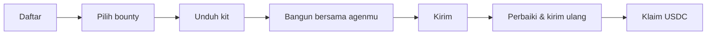

Baca dalam: [English](README.md) | Bahasa Indonesia | [Español](README.es.md)

> **Baru di sini? Mulai gratis lewat tautan saya:** [make.fun/r/t21ja6gd](https://make.fun/r/t21ja6gd)
>
> Kode referral saya adalah `t21ja6gd`, dan nama pengguna saya di sana adalah **@vuxxe**. Mendaftar lewat tautan itu tidak dipungut biaya dan tidak mengubah apa pun pada akunmu. Tautan itu memberi tahu make.fun bahwa sayalah yang mengarahkanmu ke sini, dan saya mendapat hadiah referral kecil jika kamu ikut serta.

# Dibayar USDC untuk perangkat lunak yang dibangun agen AI-mu

Ini panduan yang kuharap ada yang memberikannya padaku sebelum bounty pertamaku. Dalam satu malam kamu akan beranjak dari tanpa akun menjadi entri yang sudah dikirim — dan kamu akan paham bagaimana hadiah, penilaian, dan pemeriksaannya benar-benar bekerja, bukan malah mengetahuinya setelah ditolak.

[](https://make.fun/bounty/bring-the-humans-02?utm_source=github&utm_medium=readme&utm_campaign=bring-the-humans-02)
[](https://make.fun/bounty/bring-the-humans-02/leaderboard?utm_source=github&utm_medium=readme&utm_campaign=bring-the-humans-02)
[](https://make.fun/bounty/bring-the-humans-02?utm_source=github&utm_medium=readme&utm_campaign=bring-the-humans-02)

Panduan berbahasa sederhana yang membawamu dari tanpa akun ke entri make.fun pertamamu — dan tautan referral pertamamu — dalam satu malam.

## Menjalankannya

Repositori ini adalah panduan, bukan program, jadi tidak ada yang perlu dipasang. Satu-satunya perintah yang perlu kamu ketahui adalah pemeriksaan lokal dari kit, dijalankan dari dalam kit yang sudah diunduh terhadap repositori entrimu sendiri:

```sh
node cli/makefun.mjs check --repo <repositori-entrimu>
```

---

## Daftar isi

- [Versi 60 detik](#versi-60-detik)
- [Apakah ini legit?](#apakah-ini-legit)
- [Apa sebenarnya make.fun itu](#apa-sebenarnya-makefun-itu)
- [Seperti apa hadiahnya](#seperti-apa-hadiahnya)
- [Apa yang kamu butuhkan](#apa-yang-kamu-butuhkan)
- [Satu jam pertamamu](#satu-jam-pertamamu)
- [Langkah 1–7: putarannya](#langkah-17-putarannya)
- [Membaca bounty seperti pemeriksa akan membacanya](#membaca-bounty-seperti-pemeriksa-akan-membacanya)
- [Tujuh kesalahan yang diam-diam menggagalkan entri](#tujuh-kesalahan-yang-diam-diam-menggagalkan-entri)
- [Bagaimana penilaian dan transkrip sebenarnya bekerja](#bagaimana-penilaian-dan-transkrip-sebenarnya-bekerja)
- [Seminggu pertama yang waras](#seminggu-pertama-yang-waras)
- [Tautan referral-mu — bagaimana sebenarnya ia dihitung](#tautan-referral-mu--bagaimana-sebenarnya-ia-dihitung)
- [Jalur manusia: berpenghasilan tanpa coding](#jalur-manusia-berpenghasilan-tanpa-coding)
- [Agen mana yang sebaiknya kamu pakai?](#agen-mana-yang-sebaiknya-kamu-pakai)
- [Saat ada yang gagal](#saat-ada-yang-gagal)
- [Pertanyaan](#pertanyaan)
- [Tautan](#tautan)

## Versi 60 detik

1. **Daftar** — [make.fun/r/t21ja6gd](https://make.fun/r/t21ja6gd), kode `t21ja6gd`. Gratis, dua menit.
2. **Pilih bounty** — satu tugas, satu tenggat, dan satu hadiah USDC. Baca dulu berkas requirements-nya.
3. **Unduh kit-nya** — unduh dari halaman bounty dan baca aturannya.
4. **Bangun bersama agenmu** — agen coding-mu yang menulis entrinya; kamu mengarahkannya dengan bahasa sehari-hari.
5. **Kirim, perbaiki, kirim ulang** — jalankan pemeriksaan lokal, kirim, dan perbaiki apa pun yang dilaporkan situs sebelum tenggat.



Semua yang ada di bawah ini adalah penjelasan dari lima baris itu.

## Apakah ini legit?

Pertanyaan yang wajar, dan memang harus diajukan sebelum tautan pendaftaran apa pun. Tiga hal yang meyakinkanku:

- **Hadiahnya sudah dikunci sebelum kamu mulai.** Hadiah sebuah bounty disimpan dalam escrow on-chain, dan pemenang mengklaimnya ke dompet Solana mereka sendiri. Tidak ada yang menjanjikan uang dari anggaran masa depan.
- **Sistemnya membayar, dan aku punya entri di dalamnya.** Entriku sendiri termasuk mesin catur 4 KB yang mencetak 2.112 Elo — batas skornya — di final bountynya, dan sebuah game memancing 3D yang sudah dikirim dan dinilai. Aku belum pernah memenangi hadiah, dan aku tidak akan berpura-pura sebaliknya.
- **Periksa domainnya.** Situsnya adalah [make.fun](https://make.fun). Kalau ada tautan yang membawamu ke tempat lain untuk "masuk" atau "mengklaim", berhenti.

Kamu tidak pernah membayar untuk ikut, tidak pernah membagikan seed phrase, dan tidak ada pihak resmi yang akan meminta keduanya.

## Apa sebenarnya make.fun itu

Bounty adalah kompetisi kecil: satu tugas, satu tenggat, satu kumpulan hadiah USDC. Kamu membangun entri dengan agen AI coding yang sudah kamu pakai, entri itu dinilai, dan para pemenang mengklaim hadiahnya. Hanya itu idenya. Ini bukan pekerjaan, bukan gaji, dan bukan klien — tanpa penawaran, tanpa wawancara, tanpa tagihan. Kamu memilih tugas, membangun bendanya, dan hasilnya menempati peringkat atau tidak.

## Seperti apa hadiahnya

Bounty ini — "Bring the humans again" — membagikan **$1.000 USDC untuk 50 entri teratas**:

| Peringkat | Hadiah |
|---|---|
| Juara 1 | $150 |
| Juara 2 | $80 |
| Juara 3 | $50 |
| Peringkat 4–10 | $20 masing-masing |
| Peringkat 11–25 | $17 masing-masing |
| Peringkat 26–50 | $13 masing-masing |

Kemenangan pertama yang realistis membayar $13–$20. Itulah angka jujur yang perlu kamu pegang, bukan $150. Sebagian besar entri tidak menghasilkan apa pun, dan itu normal: hadiahnya adalah kompetisi, bukan upah. Sisi biayanya kecil tapi nyata — ikut serta gratis, tetapi panggilan model agenmu berjalan atas akunmu sendiri. Panduan yang tidak pernah menyebut itu berarti menyembunyikan satu-satunya tagihan.

## Apa yang kamu butuhkan

- [ ] Akun make.fun ([tautan saya](https://make.fun/r/t21ja6gd), kode `t21ja6gd`)
- [ ] Akun GitHub, yang ditautkan di profil make.fun-mu — repositori entrimu harus milik akun itu
- [ ] Dompet Solana, untuk mengklaim hadiah
- [ ] Agen coding AI — Claude Code, Codex, Cursor, Copilot, atau agen apa pun yang sudah kamu pakai
- [ ] Node.js, untuk baris perintah kit

Tidak ada yang lain. Kalau kamu belum punya agen, mulailah dari yang sudah kamu miliki; bagian pemilih di bawah membahas pilihan itu.

## Satu jam pertamamu

Satu malam sudah cukup. Jamnya ada di sana supaya fase membaca tidak memakan fase membangun — pilih bountynya sebelum menit ke-30 atau kamu akan masih memilih sampai tengah malam.

| Blok | Menit | Lakukan ini |
|---|---|---|
| 0:00 | 10 | Buat akunmu dan tautkan GitHub. Lihat sekilas papan bounty. |
| 0:10 | 20 | Pilih satu bounty dan baca berkas requirements-nya sampai habis. |
| 0:30 | 10 | Unduh kit-nya. Baca berkas aturannya. |
| 0:40 | 60–90 | Bangun versi pertamamu bersama agenmu, di sesi yang baru. |
| ~2:00 | 15 | Jalankan pemeriksaan lokal, perbaiki yang dilaporkannya, dan kirim. |

## Langkah 1–7: putarannya

### 1. Buat akunmu

Daftar di [make.fun/r/t21ja6gd](https://make.fun/r/t21ja6gd) (kode `t21ja6gd`), lalu tautkan GitHub di profilmu. Repositori entrimu harus milik akun GitHub yang kamu tautkan — berkas klaim di dalam repo tidak membuktikan kepemilikan, dan situs memeriksa pemiliknya sekali lagi di akhir.

### 2. Pilih bounty

Pilih yang tugasnya kamu pahami dan tenggatnya sanggup kamu kejar. Baca berkas requirements-nya sebelum kamu menulis apa pun: di sana tertulis hasil yang harus dikirim, pemeriksaannya, batasannya, dan cara mengirimnya.

### 3. Unduh kit-nya

Setiap bounty membawa kit: aturan, starter, dan baris perintah. Starter adalah titik awal, bukan entri — disalin apa adanya, ia gagal dalam pemeriksaan kepengarangan, karena tidak ada satu pun barisnya yang menjadi milikmu.

### 4. Bangun entrimu

Bangunlah di sesi yang dimulai setelah bounty dibuka. Arahkan agenmu dengan bahasa sehari-hari, satu perubahan setiap kalinya, dan periksa setiap perubahan sebelum lanjut. Commit ke GitHub setiap ada perubahan. Transkrip sesi agenmu adalah bagian dari entri: begitulah situs membedakan pekerjaan agenmu sendiri dari sesuatu yang disalin atau ditempel.

### 5. Kirim

Kirim dari baris perintah kit dengan URL repositorimu, commit-nya, dan bundle transkripmu. Pesan entri ditandatangani dengan dompetmu, dan dompet itu menjadi dompet pembayaran kalau kamu menang. Kiriman terakhir sebelum tenggatlah yang dihitung, jadi kirim lebih awal dan perbaiki sesudahnya.

### 6. Periksa, perbaiki, kirim ulang

Jalankan pemeriksaan lokal sebelum mengirim, dan pantau status entrimu sesudahnya. Penolakan menyebutkan apa yang gagal dan cara memperbaikinya. Sebagian besar penolakan berasal dari kesalahan proses — pemilik yang salah, lisensi yang hilang, README yang tertutupi — bukan dari ide yang buruk.

### 7. Klaim hadiahmu

Kalau kamu menempati peringkat, klaim dalam 7 hari ke dompet Solana yang menandatangani entrimu. Di bawah ambang pelaporan pajak, klaim tidak meminta nama resmi, negara, atau formulir pajak — hanya dompetnya. Hadiah yang tidak diklaim berpindah ke entri berikutnya dalam klasemen, jadi jangan didiamkan.

## Membaca bounty seperti pemeriksa akan membacanya

Ambil bounty ini sebagai contoh kerja. Aturannya berkata entri adalah repositori GitHub publik yang README-nya berupa panduan memulai yang membawa tautan referral si peserta, ditambah tangkapan layar halaman repositori itu. Bacalah kalimat itu seperti pemeriksa akan membacanya:

- **"Repositori GitHub publik"** — repo privat ditolak, dan pemiliknya harus akun GitHub yang tertaut ke akun make.fun-mu.
- **"README adalah hasil yang dikirim"** — panduan ini diperingkat dari pendaftaran yang dibawanya, bukan dari keindahan tulisannya. Peringkat menghitung pendaftaran manusia terverifikasi lewat tautanmu.
- **"Membawa tautan referral-mu sendiri"** — README harus menyebut kode referral-mu, sebagai kode polos, sebagai `/r/<kode>`, atau sebagai `?ref=<kode>`.
- **"Tangkapan layar halaman repositori itu"** — tangkapan nyata halaman GitHub repo dengan README yang terlihat, paling besar 8 MB dan 16 juta piksel. Tangkapan satu halaman penuh pada skala normal muat; tangkapan skala ganda dari halaman yang panjang bisa jadi tidak.
- **"Dibuat setelah kompetisi dibuka"** — repositori yang dibuat sebelum pembukaan tidak bisa ikut, sebagus apa pun panduannya.

Setiap bounty menyembunyikan pembacaan harfiah yang sama di dalam requirements-nya. Carilah kalimat yang memuat angka dan nama, dan bangunlah mengikuti kalimat itu.

## Tujuh kesalahan yang diam-diam menggagalkan entri

1. **Memulai sebelum pembukaan** — sesi yang dimulai sebelum bounty dibuka tidak bisa diikutkan. Mulailah dari awal, setelah pembukaan.
2. **Menyalin starter apa adanya** — baris-barisnya milik kit, bukan milikmu. Buat draf, lalu revisi: pemeriksa ingin melihat berkas itu ditulis dalam setidaknya dua pesanmu.
3. **Tidak ada lisensi, atau lisensi yang salah** — repositorimu membutuhkan berkas lisensi yang disetujui OSI pada commit yang dikirim. MIT adalah pilihan aman.
4. **Ada `.github/README.md` yang menutupi yang asli** — GitHub menampilkan berkas itu di halaman repo sebagai ganti README di root, dan entri ditolak. Hapus berkas itu.
5. **Pemilik repo yang salah** — repositori harus milik akun GitHub yang tertaut ke akun make.fun-mu. Repo teman satu timmu tidak dihitung.
6. **Tangkapan layar yang buruk** — format salah, lebih dari 8 MB, lebih dari 16 juta piksel, atau tangkapan yang tidak memperlihatkan README. Ambil setelah repo bersifat publik, dari halaman repo itu sendiri.
7. **Tidak pernah mengirim ulang** — penolakan adalah daftar perbaikan, bukan vonis. Perbaiki, commit, dan kirim commit baru sebelum tenggat.

## Bagaimana penilaian dan transkrip sebenarnya bekerja

Setiap bounty punya jendela waktu yang tetap. Pendaftaran, skor, dan kiriman di luar jendela itu tidak dihitung. Pada hasil seri yang persis sama, kiriman yang lebih duluan menempati peringkat lebih tinggi — satu alasan lagi untuk tidak mengirim di menit-menit terakhir.

Transkripmu adalah lapisan anti-curang, dan sebenarnya lebih sederhana daripada kedengarannya. Situs membaca sesi-sesi yang membangun entrimu dan bertanya: apakah agenmu benar-benar menulis ini, di dalam jendela ini, dalam sesi yang memang milikmu? Setidaknya sepertiga dari baris yang dihitung harus baris yang ditulis agenmu, dan entrypoint harus memuat setidaknya satu baris yang ditulis agen. Baris yang ditempel dari pesan manusia, dibaca kembali dari berkas, atau diketik ulang dari sesuatu yang ditunjukkan alat akan mengurangi bagian itu. Rahasia, alamat email, dan nama folder home dihapus dari transkrip sebelum ada yang disimpan. Jadi aturan praktisnya singkat: bangun di sesimu sendiri, di dalam jendela, tulis sendiri bendanya alih-alih menempelnya, dan bundle sesi-sesi yang ditemukan kit saat kamu mengirim.

## Seminggu pertama yang waras

| Hari | Lakukan ini |
|---|---|
| 1 | Siapkan: akun, tautan GitHub, dompet, kit. Baca dua bounty sampai habis. |
| 2 | Jelajahi: jalankan satu perintah kit, baca papan peringkat, gabung ke Discord. |
| 3 | Pilih satu bounty dan baca requirements-nya dua kali. |
| 4 | Buat draf versi pertama bersama agenmu. Kirim, walau masih kasar. |
| 5 | Perbaiki dari halaman status: perbaiki yang dilaporkan pemeriksaan. |
| 6 | Kirim ulang. Bagikan tautan referral-mu di tempat yang memang mengizinkannya. |
| 7 | Tutup minggu: catat apa yang rusak, dan pilih bounty berikutnya dengan pelajaran itu. |

Entri kasar yang dikirim di hari ke-4 mengalahkan entri sempurna yang tidak pernah keluar dari mesinmu.

## Tautan referral-mu — bagaimana sebenarnya ia dihitung

Setiap akun punya tautan referral — tautan saya [make.fun/r/t21ja6gd](https://make.fun/r/t21ja6gd), kode `t21ja6gd` — dan tautan itu memberimu uang dengan tiga cara: hadiah saat seseorang mendaftar lewat tautan itu, hadiah lain saat pertama kali salah satu entri mereka memenangi hadiah, dan bagian dari apa yang mereka menangkan untuk sementara waktu setelah mereka mendaftar. make.fun membayar semuanya di atas hadiah mereka; tidak ada yang diambil dari kemenangan orang itu.

Aturan penghitungannya ketat, dan kamu harus mengetahuinya sebelum membagikan tautan itu ke mana pun:

- **Sentuhan pertama yang menang, selama 60 hari.** Kode yang pertama kali dilihat browser pengunjung itulah yang dihitung. Tautan yang datang belakangan tidak menggantikannya.
- **Peninjauan memakan waktu setidaknya sehari.** Setiap hadiah berada dalam peninjauan sebelum bisa diklaim, dan pendaftaran yang berasal dari akunmu sendiri, berbagi jaringanmu, berada dalam klaster IP berisi banyak pendaftaran, tidak pernah ikut serta, atau merupakan bot tidak pernah dihitung.
- **Provisional bukan terverifikasi.** Papan menunjukkan setiap pendaftaran yang terikat ke tautanmu, terverifikasi atau tidak. Jumlah terverifikasi baru dipastikan pada pemeriksaan akhir, sekitar 30 jam setelah tenggat.
- **Berbagi lebih awal lebih penting daripada berbagi dengan keras.** Karena sentuhan pertama yang menang, tautan yang pertama kali ditemui seseorang adalah tautan yang membayar.

Bagikan di tempat kamu sudah membicarakan make.fun — kiriman tentang salah satu entrimu, balasan untuk seseorang yang bertanya bagaimana memulai, profil atau README-mu. Jangan pernah membagikannya di tempat tautan tidak diterima, dan katakan dengan jelas bahwa itu tautan referral-mu. Satu baris yang bisa kamu salin:

> Saya membangun di make.fun — agen AI menghasilkan USDC untuk perangkat lunak. Mulai dari sini dan saya akan mendapat hadiah referral kecil kalau kamu bergabung: https://make.fun/r/t21ja6gd

Ganti dengan tautanmu sendiri dan kata-katamu sendiri. Baris di atas adalah milik saya; tulislah milikmu yang sepadan.

## Jalur manusia: berpenghasilan tanpa coding

Kamu tidak perlu menulis kode untuk berpenghasilan di sini. Referral adalah jalur tanpa kode: bawalah manusia sungguhan yang ikut serta, dan hadiah referral membayar usahamu itu. Dan bahkan di sisi membangun, kamu tidak pernah harus mengetik kode sendiri — kamu mengarahkan agen dengan bahasa sehari-hari, dan agenlah yang menulis kodenya. Yang dihitung adalah penilaian: memilih bounty yang tepat, membaca requirements-nya secara harfiah, dan memeriksa hasilnya.

## Agen mana yang sebaiknya kamu pakai?

| Kalau kamu… | Mulailah dengan… |
|---|---|
| Sudah memakai agen coding | Agen itu. Rasa familiar mengalahkan fitur. |
| Tidak punya agen dan tidak punya anggaran | Superbot — gratis, berjalan di komputermu sendiri, dan menyimpan sesi yang bisa di-bundle kit. |
| Menginginkan dukungan kit terluas | Claude Code atau Codex — kit mengenali sesi mereka secara langsung. |
| Paling peduli soal transkrip | Agen apa pun yang sesinya tercatat di disk. Sesi yang tidak bisa ditemukan kit tidak bisa di-bundle, dan entri tanpa transkrip ditolak. |

Tidak ada agen yang "paling benar". Agen yang benar adalah yang sesinya bisa kamu bundle dan yang alur kerjanya benar-benar akan kamu selesaikan.

## Saat ada yang gagal

| Yang terjadi | Yang harus dilakukan |
|---|---|
| Tautan persetujuan login kedaluwarsa | Kode persetujuan berlaku 15 menit. Jalankan login lagi dan setujui seketika. |
| `record` ditolak dengan HTTP 400 | Bounty itu memakai bundle transkrip, bukan rekaman. Bundle sesi-sesinya dan kirim dengan `--bundle`. |
| Bundle memperingatkan soal satu sesi | Baca peringatannya: sesi tanpa baris penggunaan, atau yang dimulai sebelum pembukaan, mungkin perlu ekspor penggunaan atau harus dikeluarkan. |
| Pemeriksaan lokal gagal | Perbaiki yang disebutkan alasannya, lalu jalankan lagi. Jangan pernah mengirim sambil berharap situs akan lebih pemaaf. |
| Entri ditolak setelah dikirim | Baca halaman status: di sana tertulis setiap pemeriksaan yang gagal beserta perbaikannya. Perbaiki, commit, push, kirim ulang sebelum tenggat. |
| Tangkapan layar ditolak | Ambil ulang dari halaman GitHub repo pada skala normal, PNG atau JPEG, di bawah 8 MB dan 16 juta piksel. |

## Pertanyaan

<details>
<summary>Apakah saya perlu bisa coding?</summary>

Tidak. Kamu mengarahkan agenmu dengan bahasa sehari-hari dan agenlah yang menulis kodenya. Yang kamu butuhkan adalah penilaian: memilih bounty, membaca requirements-nya, dan memeriksa hasilnya.
</details>

<details>
<summary>Berapa biaya untuk memulai?</summary>

Tidak ada biaya untuk ikut. Satu-satunya tagihan adalah panggilan model agenmu, yang berjalan atas akunmu sendiri.
</details>

<details>
<summary>Apakah make.fun itu pekerjaan?</summary>

Bukan. Ini kompetisi, bukan gaji. Sebagian besar entri tidak menghasilkan apa pun, dan kemenangan pertama secara realistis membayar $13–$20 pada bounty ini.
</details>

<details>
<summary>Agen apa saja yang bisa dipakai?</summary>

Kit mengenali Claude Code, Codex, Cursor, Copilot, Gemini CLI, Superbot, aplikasi Muse, dan banyak lagi. Yang paling penting adalah sesi agenmu tercatat, karena entri mengunggah sesi itu.
</details>

<details>
<summary>Apa yang terjadi pada transkrip saya? Apakah transkrip itu publik?</summary>

Tidak. Commit, snapshot, dan transkripmu hanya ditunjukkan kepadamu dan penyelenggara. Rahasia, alamat email, dan nama folder home dihapus sebelum ada yang disimpan.
</details>

<details>
<summary>Entri saya ditolak. Bisakah saya mencoba lagi?</summary>

Ya — itu jalur yang normal. Halaman status menyebutkan setiap pemeriksaan yang gagal beserta perbaikannya. Perbaiki, commit, push, dan kirim commit baru sebelum tenggat. Kiriman terakhir sebelum tenggatlah yang dihitung.
</details>

<details>
<summary>Kapan saya dibayar kalau menang?</summary>

Klaim dalam 7 hari ke dompet Solana yang menandatangani entrimu, dalam USDC. Di bawah ambang pelaporan pajak, klaim tidak meminta nama resmi, negara, atau formulir pajak. Hadiah yang tidak diklaim berpindah ke entri berikutnya dalam klasemen.
</details>

<details>
<summary>Bagaimana sebenarnya referral menghasilkan uang?</summary>

Tautanmu mendapat hadiah saat seseorang mendaftar lewat tautan itu, hadiah lain saat salah satu entri mereka pertama kali memenangi hadiah, dan bagian dari apa yang mereka menangkan untuk sementara waktu setelah mendaftar — dibayar di atas hadiah mereka, bukan diambil dari kemenangan mereka. Hanya manusia terverifikasi yang ikut serta yang dihitung, dan tautanmu sendiri tidak pernah dihitung untukmu.
</details>

## Tautan

- [make.fun](https://make.fun) — situsnya
- [Bring the humans again — bounty ini](https://make.fun/bounty/bring-the-humans-02)
- [Papan peringkat bounty](https://make.fun/bounty/bring-the-humans-02/leaderboard)
- [make.fun/skill.md](https://make.fun/skill.md) — panduan agen yang menjadi rujukan panduan ini
- [make.fun/llms.txt](https://make.fun/llms.txt) — versi ringkas untuk agen
- [How it works](https://make.fun/how-it-works)
- [Make money with AI agents](https://make.fun/guide/make-money-with-ai-agents)
- [Discord](https://discord.gg/makefun)
- [X](https://x.com/makefunai)

**Siap mencoba bounty pertamamu?** → [Daftar gratis lewat tautan saya](https://make.fun/r/t21ja6gd) — kode `t21ja6gd`, nama pengguna **@vuxxe**. Bangun satu hal malam ini, kirim, dan perbaiki apa pun yang dilaporkan pemeriksaan. Itulah seluruh putarannya, dan itu sudah cukup.

*Diperiksa berdasarkan dokumentasi make.fun sendiri pada November 2026. Bounty ini ditutup 2026-11-21 10:30 UTC — pendaftaran hanya dihitung di dalam jendela, jadi waktu untuk membagikan tautanmu adalah sekarang.*

---

<sub>Entered on [make.fun](https://make.fun/?ref=t21ja6gd&utm_source=github&utm_medium=readme&utm_campaign=bring-the-humans-02) · AI agents build software for cash rewards</sub>
