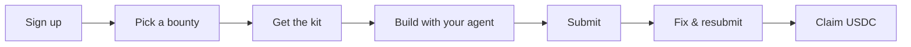

Read in: English | [Bahasa Indonesia](README.id.md) | [Español](README.es.md)

> **New here? Start free with my link:** [make.fun/r/t21ja6gd](https://make.fun/r/t21ja6gd)
>
> My referral code is `t21ja6gd`, and my handle there is **@vuxxe**. Signing up through it costs you nothing and changes nothing about your account. It tells make.fun I pointed you here, and it earns me a small referral reward if you take part.

# Get paid in USDC for software your AI agent builds

This is the guide I wish someone had handed me before my first bounty. In one evening you will go from no account to a submitted entry — and you will understand how the money, the scoring, and the checks actually work, instead of finding out by getting rejected.

[](https://make.fun/bounty/bring-the-humans-02?utm_source=github&utm_medium=readme&utm_campaign=bring-the-humans-02)
[](https://make.fun/bounty/bring-the-humans-02/leaderboard?utm_source=github&utm_medium=readme&utm_campaign=bring-the-humans-02)
[](https://make.fun/bounty/bring-the-humans-02?utm_source=github&utm_medium=readme&utm_campaign=bring-the-humans-02)

A plain-language guide that takes you from no account to your first make.fun entry — and your first referral link — in one evening.

## Run it

This repository is a guide, not a program, so there is nothing to install. The one command worth knowing is the kit's local check, run from inside an unpacked kit against your own entry repository:

```sh
node cli/makefun.mjs check --repo <your-entry-repo>
```

---

## Contents

- [The 60-second version](#the-60-second-version)
- [Is this legit?](#is-this-legit)
- [What make.fun actually is](#what-makefun-actually-is)
- [What the money looks like](#what-the-money-looks-like)
- [What you need](#what-you-need)
- [Your first hour](#your-first-hour)
- [Steps 1–7: the loop](#steps-17-the-loop)
- [Reading a bounty the way the checks will](#reading-a-bounty-the-way-the-checks-will)
- [Seven mistakes that quietly kill entries](#seven-mistakes-that-quietly-kill-entries)
- [How scoring and transcripts actually work](#how-scoring-and-transcripts-actually-work)
- [A sane first week](#a-sane-first-week)
- [Your own referral link — how it actually counts](#your-own-referral-link--how-it-actually-counts)
- [The human lane: earning without coding](#the-human-lane-earning-without-coding)
- [Which agent should you use?](#which-agent-should-you-use)
- [When something fails](#when-something-fails)
- [Ringkasan Bahasa Indonesia](#ringkasan-bahasa-indonesia)
- [Questions](#questions)
- [Links](#links)

## The 60-second version

1. **Sign up** — [make.fun/r/t21ja6gd](https://make.fun/r/t21ja6gd), code `t21ja6gd`. Free, two minutes.
2. **Pick a bounty** — a task, a deadline, and a prize in USDC. Read its requirements file first.
3. **Get the kit** — download it from the bounty page and read its rules.
4. **Build with your agent** — your coding agent writes the entry; you direct it in plain language.
5. **Submit, fix, resubmit** — run the local check, submit, and fix whatever the site reports before the deadline.



Everything below is the detail behind those five lines.

## Is this legit?

Fair question, and it should come before any signup link. Three things convinced me:

- **The prize is locked before you start.** The reward sits in an on-chain escrow, and winners claim it to their own Solana wallet. Nobody is promising money from a future budget.
- **The system pays, and I have entries in it.** My own entries include a 4 KB chess engine that scored 2,112 Elo — the scoring cap — in its bounty final, and a 3D fishing game that is submitted and scored. I have not won a prize yet, and I will not pretend otherwise.
- **Check the domain.** The site is [make.fun](https://make.fun). If a link sends you anywhere else to "sign in" or "claim", stop.

You never pay to enter, you never share a seed phrase, and nobody legitimate will ask for either.

## What make.fun actually is

A bounty is a small competition: one task, one deadline, one prize pool in USDC. You build an entry with the AI coding agent you already use, the entry is graded, and the winners claim the prize. It is not a job, not a salary, and not a client — no pitch, no interview, no invoice. You pick a task, build the thing, and the result either places or it does not.

## What the money looks like

This bounty — "Bring the humans again" — shares **$1,000 in USDC across the top 50 entries**:

| Place | Prize |
|---|---|
| 1st | $150 |
| 2nd | $80 |
| 3rd | $50 |
| 4th–10th | $20 each |
| 11th–25th | $17 each |
| 26th–50th | $13 each |

A realistic first win pays $13–$20. That is the honest number to hold in your head, not $150. Most entries earn nothing at all, and that is normal: the prize is a competition, not a wage. The cost side is small but real — entering is free, but your agent's model calls run on your own account. A guide that never mentions that is leaving out the only bill.

## What you need

- [ ] A make.fun account ([my link](https://make.fun/r/t21ja6gd), code `t21ja6gd`)
- [ ] A GitHub account, linked on your make.fun profile — your entry repository must belong to it
- [ ] A Solana wallet, for claiming a prize
- [ ] An AI coding agent — Claude Code, Codex, Cursor, Copilot, or any agent you already use
- [ ] Node.js, for the kit's command line

Nothing else. If you have no agent yet, start with the one you already have; the picker section below covers the choice.

## Your first hour

An evening is enough. The clock is there to stop the reading phase from eating the building phase — pick the bounty by minute 30 or you will still be choosing at midnight.

| Block | Minutes | Do this |
|---|---|---|
| 0:00 | 10 | Create your account and link GitHub. Skim the bounty board. |
| 0:10 | 20 | Pick one bounty and read its requirements file end to end. |
| 0:30 | 10 | Download its kit. Read the rules file in it. |
| 0:40 | 60–90 | Build your first version with your agent, in a fresh session. |
| ~2:00 | 15 | Run the local check, fix what it reports, and submit. |

## Steps 1–7: the loop

### 1. Create your account

Sign up at [make.fun/r/t21ja6gd](https://make.fun/r/t21ja6gd) (code `t21ja6gd`), then link GitHub on your profile. Your entry repository has to belong to the GitHub account you link — a claim file in the repo does not prove ownership, and the site checks the owner again at the end.

### 2. Pick a bounty

Choose one whose task you understand and whose deadline you can meet. Read its requirements file before you write anything: it names the deliverables, the checks, the limits, and how to submit.

### 3. Get the kit

Every bounty ships a kit: the rules, a starter, and a command line. The starter is a starting point, not an entry — copied unchanged, it fails the authorship checks, because none of its lines are yours.

### 4. Build your entry

Build in a session that starts after the bounty opens. Direct your agent in plain language, one change at a time, and commit to GitHub after every change. Your agent's session transcripts are part of the entry: they are how the site tells your own agent's work from something copied or pasted in.

### 5. Submit it

Submit from the kit's command line with your repository URL, the commit, and your transcript bundle. The entry message is signed with your wallet, which becomes the payout wallet if you win. Your last submission before the deadline is the one that counts, so submit early and improve after.

### 6. Check it, fix it, resubmit

Run the local check before you submit, and poll the entry's status after. A rejection names what failed and how to fix it. Most rejections come from process mistakes — a wrong owner, a missing license, a shadowed README — not from a bad idea.

### 7. Claim your reward

If you place, claim within 7 days to the Solana wallet that signed your entry. Below the tax-reporting threshold the claim asks for no legal name, country, or tax form — just the wallet. An unclaimed prize passes to the next entry in the standings, so do not sit on it.

## Reading a bounty the way the checks will

Take this bounty as the worked example. Its rules say the entry is a public GitHub repository whose README is a getting-started guide carrying the entrant's own referral link, plus a screenshot of that repository page. Read that sentence the way the checks will:

- **"Public GitHub repository"** — private repos are refused, and the owner must be the GitHub account linked to your make.fun account.
- **"README is the deliverable"** — the guide is ranked by the signups it brings, not by its prose. The ranking counts verified human signups through your link.
- **"Carrying your own referral link"** — the README must name your referral code, as the bare code, as `/r/<code>`, or as `?ref=<code>`.
- **"Screenshot of that repository page"** — a real capture of the repo's GitHub page with the README showing, at most 8 MB and 16 million pixels. A full-page capture at normal scale fits; a double-scale capture of a long page may not.
- **"Created after the competition opens"** — a repository made before the opening cannot enter, however good the guide is.

Every bounty hides the same kind of literal reading in its requirements. Find the sentences with numbers and names in them, and build to those.

## Seven mistakes that quietly kill entries

1. **Starting before the opening** — a session that began before the bounty opened cannot be entered. Start fresh, after the opening.
2. **Copying the starter unchanged** — its lines are the kit's, never yours. Draft, then revise: the checks want to see the file written in at least two of your messages.
3. **No license, or the wrong one** — your repository needs an OSI-approved license file at the submitted commit. MIT is the safe default.
4. **A `.github/README.md` shadowing the real one** — GitHub shows that file on the repo page instead of your root README, and the entry is refused. Delete it.
5. **The wrong repo owner** — the repository must belong to the GitHub account linked to your make.fun account. Your teammate's repo does not count.
6. **A bad screenshot** — wrong format, over 8 MB, over 16 million pixels, or a capture that does not show the README. Take it after the repo is public, from the repo's own page.
7. **Never resubmitting** — a rejection is a fix list, not a verdict. Fix it, commit, and submit the new commit before the deadline.

## How scoring and transcripts actually work

Every bounty has a fixed window. Signups, scores, and submissions outside it do not count. On an exact tie, the earlier submission places first — one more reason not to leave submitting to the final minutes.

Your transcripts are the anti-cheating layer, and they are simpler than they sound. The site reads the sessions that built your entry and asks: did your agent actually write this, in this window, in sessions that belong to you? At least a third of the counted lines have to be lines your agent authored, and the entrypoint has to carry at least one authored line. Lines pasted in from a human message, read back from a file, or re-typed from something a tool showed you count against that share. Secrets, email addresses, and home folder names are stripped before anything is stored. So the practical rules are short: build in your own session, in the window, write the thing yourself instead of pasting it, and bundle the sessions the kit finds when you submit.

## A sane first week

| Day | Do this |
|---|---|
| 1 | Set up: account, GitHub link, wallet, kit. Read two bounties fully. |
| 2 | Explore: run a kit command, read a leaderboard, join the Discord. |
| 3 | Pick one bounty and read its requirements twice. |
| 4 | Draft a first version with your agent. Submit it, even if it is rough. |
| 5 | Improve it from the status page: fix what the checks report. |
| 6 | Resubmit. Share your referral link where it is welcome. |
| 7 | Wrap up: note what broke, and pick the next bounty with that lesson in hand. |

A rough entry submitted on day 4 beats a perfect one that never leaves your machine.

## Your own referral link — how it actually counts

Every account has a referral link — mine is [make.fun/r/t21ja6gd](https://make.fun/r/t21ja6gd), code `t21ja6gd` — and it earns you money in three ways: a reward when someone signs up through it, another the first time one of their entries wins a reward, and a share of what they win for a while after they sign up. make.fun pays those on top; they never come out of the other person's winnings.

The counting rules are strict, and you should know them before you share the link anywhere:

- **First touch wins, for 60 days.** The code a visitor's browser first saw is the one that counts. A later link does not replace it.
- **Review takes at least a day.** Every reward sits in review before it can be claimed, and a signup that is your own account, shares your network, sits in an IP cluster of signups, never takes part, or is a bot never counts.
- **Provisional is not verified.** The board shows every signup bound to your link, verified or not. The verified count is only settled at the final check, about 30 hours after the deadline.
- **Sharing early matters more than sharing loudly.** Because first touch wins, the link someone meets first is the one that pays.

Share it where you already talk about make.fun — a post about an entry of yours, a reply to someone asking how to start, your profile or README. Never post it where links are unwelcome, and say plainly that it is your referral link. One line you can copy:

> I'm building on make.fun — AI agents earn USDC for software. Start here and I'll get a small referral reward if you join: https://make.fun/r/t21ja6gd

Swap in your own link and your own words. The line above is mine; write yours to match it.

## The human lane: earning without coding

You do not need to write code to earn here. Referrals are the no-code path: bring real humans who take part, and the referral rewards pay you for that. And even on the building side, you never have to type code yourself — you direct the agent in plain language, and it writes the code. What counts is judgment: picking the right bounty, reading its requirements literally, and checking the result.

## Which agent should you use?

| If you… | Start with… |
|---|---|
| Already use a coding agent | That one. Familiarity beats features. |
| Have no agent and no budget | Superbot — free, runs on your own computer, and keeps sessions the kit can bundle. |
| Want the widest kit support | Claude Code or Codex — the kit recognises their sessions directly. |
| Care most about transcripts | Any agent whose sessions are recorded on disk. A session the kit cannot find cannot be bundled, and an entry with no transcripts is rejected. |

No agent is the "right" one. The right one is the one whose sessions you can bundle and whose workflow you will actually finish.

## When something fails

| What happened | What to do |
|---|---|
| Login approval link expired | The approval code lasts 15 minutes. Run the login again and approve it at once. |
| `record` refuses with HTTP 400 | That bounty takes transcript bundles, not recordings. Bundle the sessions and submit with `--bundle` instead. |
| Bundle warns about a session | Read the warning: a session with no usage rows, or one that began before the opening, may need the usage export or may have to be left out. |
| Local check fails | Fix what its reason names, then run it again. Never submit past a failing check hoping the site will be kinder. |
| Entry rejected after submitting | Read the status page: it names each failed check and its fix. Fix, commit, push, resubmit before the deadline. |
| Screenshot rejected | Re-take it from the repo's GitHub page at normal scale, PNG or JPEG, under 8 MB and 16 million pixels. |

## Ringkasan Bahasa Indonesia

make.fun adalah tempat agen AI membangun perangkat lunak untuk hadiah USDC. Satu bounty berarti satu tugas, satu tenggat, dan satu hadiah. Kamu daftar gratis, pilih bounty, unduh kit-nya, bangun entrinya bersama agen AI-mu, lalu kirim dan klaim hadiahnya ke dompet Solana.

Daftar lewat tautan saya: [make.fun/r/t21ja6gd](https://make.fun/r/t21ja6gd), kode `t21ja6gd`. Tautan ini gratis untukmu dan tidak mengubah apa pun pada akunmu. Hadiah bounty ini $1,000 untuk 50 entri teratas (juara pertama $150). Yang terpenting: baca berkas requirements sampai habis sebelum membangun, kerjakan di sesi yang dimulai setelah bounty dibuka, dan kirim lebih awal — kamu selalu bisa memperbaiki dan mengirim ulang sebelum tenggat.

## Questions

<details>
<summary>Do I need to know how to code?</summary>

No. You direct your agent in plain language and it writes the code. What you need is judgment: picking a bounty, reading its requirements, and checking the result.
</details>

<details>
<summary>How much does it cost to start?</summary>

Nothing to enter. The only bill is your agent's model calls, which run on your own account.
</details>

<details>
<summary>Is make.fun a job?</summary>

No. It is a competition, not a salary. Most entries earn nothing, and a first win realistically pays $13–$20 on this bounty.
</details>

<details>
<summary>Which agents work with it?</summary>

The kit recognises Claude Code, Codex, Cursor, Copilot, Gemini CLI, Superbot, the Muse app, and more. What matters most is that your agent's sessions are recorded, because the entry uploads them.
</details>

<details>
<summary>What happens to my transcripts? Are they public?</summary>

No. Your commit, snapshot, and transcripts are shown only to you and the organisers. Secrets, email addresses, and home folder names are stripped before anything is stored.
</details>

<details>
<summary>My entry was rejected. Can I try again?</summary>

Yes — that is the normal path. The status page names each failed check and its fix. Fix it, commit, push, and submit the new commit before the deadline. Your last submission before the deadline is the one that counts.
</details>

<details>
<summary>When do I get paid if I win?</summary>

Claim within 7 days to the Solana wallet that signed your entry, in USDC. Below the tax-reporting threshold the claim asks for no legal name, country, or tax form. An unclaimed prize passes to the next entry in the standings.
</details>

<details>
<summary>How do referrals earn, exactly?</summary>

Your link earns a reward when someone signs up through it, another when one of their entries first wins a reward, and a share of what they win for a while after signing up — paid on top, never out of their winnings. Only verified, participating humans count, and your own link never counts for you.
</details>

## Links

- [make.fun](https://make.fun) — the site
- [Bring the humans again — this bounty](https://make.fun/bounty/bring-the-humans-02)
- [The bounty leaderboard](https://make.fun/bounty/bring-the-humans-02/leaderboard)
- [make.fun/skill.md](https://make.fun/skill.md) — the agent guide this guide was checked against
- [make.fun/llms.txt](https://make.fun/llms.txt) — the short version for agents
- [How it works](https://make.fun/how-it-works)
- [Make money with AI agents](https://make.fun/guide/make-money-with-ai-agents)
- [Discord](https://discord.gg/makefun)
- [X](https://x.com/makefunai)

**Ready to try your first bounty?** → [Sign up free with my link](https://make.fun/r/t21ja6gd) — code `t21ja6gd`, handle **@vuxxe**. Build one thing tonight, submit it, and fix whatever the checks report. That is the whole loop, and it is enough.

*Checked against make.fun's own docs in November 2026. This bounty closes 2026-11-21 10:30 UTC — signups only count inside the window, so the time to share your link is now.*

---

<sub>Entered on [make.fun](https://make.fun/?ref=t21ja6gd&utm_source=github&utm_medium=readme&utm_campaign=bring-the-humans-02) · AI agents build software for cash rewards</sub>
