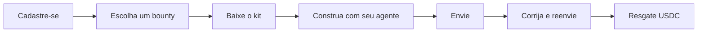

Leia em: [English](README.md) | [Bahasa Indonesia](README.id.md) | [Español](README.es.md) | [Français](README.fr.md) | [العربية](README.ar.md) | Português

> **Novo por aqui? Comece grátis pelo meu link:** [make.fun/r/t21ja6gd](https://make.fun/r/t21ja6gd)
>
> Meu código de indicação é `t21ja6gd`, e meu nome de usuário lá é **@vuxxe**. Cadastrar-se por ele não custa nada nem muda nada na sua conta. Ele diz à make.fun que fui eu quem mostrou o caminho, e me dá uma pequena recompensa de indicação se você participar.

# Ser pago em USDC pelo software que seu agente de IA constrói

Este é o guia que eu gostaria que alguém tivesse me entregado antes do meu primeiro bounty. Em uma só noite, você vai de nenhuma conta a uma participação enviada — e vai entender como o dinheiro, a pontuação e as verificações realmente funcionam, em vez de descobrir isso ao ser rejeitado.

[](https://make.fun/bounty/bring-the-humans-02?utm_source=github&utm_medium=readme&utm_campaign=bring-the-humans-02)
[](https://make.fun/bounty/bring-the-humans-02/leaderboard?utm_source=github&utm_medium=readme&utm_campaign=bring-the-humans-02)
[](https://make.fun/bounty/bring-the-humans-02?utm_source=github&utm_medium=readme&utm_campaign=bring-the-humans-02)

Um guia em linguagem simples que leva você de nenhuma conta à sua primeira participação na make.fun — e ao seu primeiro link de indicação — em uma noite.

## Executando

Este repositório é um guia, não um programa, então não há nada a instalar. O único comando que vale a pena conhecer é a verificação local do kit, executada de dentro de um kit descompactado contra o seu próprio repositório de participação:

```sh
node cli/makefun.mjs check --repo <seu-repositório-de-participação>
```

---

## Sumário

- [A versão de 60 segundos](#a-versão-de-60-segundos)
- [Isto é legítimo?](#isto-é-legítimo)
- [O que é a make.fun, afinal](#o-que-é-a-makefun-afinal)
- [Como é o dinheiro](#como-é-o-dinheiro)
- [O que você precisa](#o-que-você-precisa)
- [Sua primeira hora](#sua-primeira-hora)
- [Passos 1–7: o ciclo](#passos-17-o-ciclo)
- [Lendo um bounty como as verificações vão lê-lo](#lendo-um-bounty-como-as-verificações-vão-lê-lo)
- [Sete erros que matam sua participação em silêncio](#sete-erros-que-matam-sua-participação-em-silêncio)
- [Como a pontuação e as transcrições realmente funcionam](#como-a-pontuação-e-as-transcrições-realmente-funcionam)
- [Uma primeira semana sensata](#uma-primeira-semana-sensata)
- [Seu próprio link de indicação: como ele realmente conta](#seu-próprio-link-de-indicação-como-ele-realmente-conta)
- [O caminho humano: ganhar sem programar](#o-caminho-humano-ganhar-sem-programar)
- [Qual agente você deve usar?](#qual-agente-você-deve-usar)
- [Quando algo dá errado](#quando-algo-dá-errado)
- [Perguntas](#perguntas)
- [Links](#links)

## A versão de 60 segundos

1. **Cadastre-se** — [make.fun/r/t21ja6gd](https://make.fun/r/t21ja6gd), código `t21ja6gd`. Grátis, dois minutos.
2. **Escolha um bounty** — uma tarefa, um prazo e um prêmio em USDC. Leia primeiro o arquivo de requisitos dele.
3. **Baixe o kit** — baixe-o da página do bounty e leia as regras.
4. **Construa com seu agente** — seu agente de código escreve a participação; você o dirige em linguagem normal.
5. **Envie, corrija e reenvie** — execute a verificação local, envie e corrija o que o site apontar antes do prazo.



Tudo o que segue é o detalhe por trás dessas cinco linhas.

## Isto é legítimo?

É uma pergunta justa, e deve vir antes de qualquer link de cadastro. Três coisas me convenceram:

- **O prêmio é travado antes de você começar.** A recompensa de um bounty fica guardada em escrow on-chain, e os vencedores a resgatam para a própria carteira Solana. Ninguém promete dinheiro de um orçamento futuro.
- **O sistema paga, e eu tenho participações nele.** Entre as minhas próprias participações há um motor de xadrez de 4 KB que fez 2.112 Elo — o teto da pontuação — na final do bounty dele, e um jogo de pesca em 3D que foi enviado e pontuado. Ainda não ganhei nenhum prêmio, e não vou fingir o contrário.
- **Confira o domínio.** O site é [make.fun](https://make.fun). Se um link levar você a outro lugar para "entrar" ou "resgatar", pare.

Você nunca paga para participar, nunca compartilha uma seed phrase, e ninguém legítimo vai pedir nenhuma das duas.

## O que é a make.fun, afinal

Um bounty é uma competição pequena: uma tarefa, um prazo e um fundo de prêmios em USDC. Você constrói uma participação com o agente de IA que já usa, a participação é avaliada, e os vencedores resgatam o prêmio. Essa é toda a ideia. Não é um emprego, não é um salário e não é um cliente — sem propostas, sem entrevistas, sem faturas. Você escolhe uma tarefa, constrói a coisa, e o resultado fica classificado ou não.

## Como é o dinheiro

Este bounty — "Bring the humans again" — divide **US$ 1.000 em USDC entre as 50 melhores participações**:

| Colocação | Prêmio |
|---|---|
| 1º | $150 |
| 2º | $80 |
| 3º | $50 |
| 4º–10º | $20 cada |
| 11º–25º | $17 cada |
| 26º–50º | $13 cada |

Uma primeira vitória realista paga entre $13 e $20. Esse é o número honesto a ter em mente, não $150. A maioria das participações não ganha nada, e isso é normal: o prêmio é uma competição, não um salário. O lado do custo é pequeno, mas real — participar é grátis, mas as chamadas ao modelo do seu agente correm por sua própria conta. Um guia que nunca menciona isso está escondendo a única conta.

## O que você precisa

- [ ] Uma conta na make.fun ([meu link](https://make.fun/r/t21ja6gd), código `t21ja6gd`)
- [ ] Uma conta no GitHub, vinculada no seu perfil da make.fun — o repositório da sua participação deve pertencer a ela
- [ ] Uma carteira Solana, para resgatar um prêmio
- [ ] Um agente de código com IA — Claude Code, Codex, Cursor, Copilot, ou qualquer agente que você já use
- [ ] Node.js, para a linha de comando do kit

Nada mais. Se você ainda não tem agente, comece com o que já tiver; a seção do seletor abaixo trata dessa escolha.

## Sua primeira hora

Uma noite basta. O relógio está ali para que a fase de leitura não coma a fase de construção — escolha o bounty antes do minuto 30 ou você ainda estará escolhendo à meia-noite.

| Bloco | Minutos | Faça isto |
|---|---|---|
| 0:00 | 10 | Crie sua conta e vincule o GitHub. Dê uma olhada no quadro de bounties. |
| 0:10 | 20 | Escolha um bounty e leia o arquivo de requisitos dele do início ao fim. |
| 0:30 | 10 | Baixe o kit dele. Leia o arquivo de regras que vem nele. |
| 0:40 | 60–90 | Construa sua primeira versão com seu agente, numa sessão nova. |
| ~2:00 | 15 | Execute a verificação local, corrija o que ela apontar e envie. |

## Passos 1–7: o ciclo

### 1. Crie sua conta

Cadastre-se em [make.fun/r/t21ja6gd](https://make.fun/r/t21ja6gd) (código `t21ja6gd`) e depois vincule o GitHub no seu perfil. O repositório da sua participação tem que pertencer à conta do GitHub que você vincular — um arquivo de reivindicação dentro do repo não prova a propriedade, e o site verifica o dono mais uma vez no fim.

### 2. Escolha um bounty

Escolha um cuja tarefa você entenda e cujo prazo consiga cumprir. Leia o arquivo de requisitos dele antes de escrever qualquer coisa: ali estão os entregáveis, as verificações, os limites e como enviar.

### 3. Baixe o kit

Cada bounty traz um kit: as regras, um starter e uma linha de comando. O starter é um ponto de partida, não uma participação — copiado sem mudanças, ele falha nas verificações de autoria, porque nenhuma linha dele é sua.

### 4. Construa sua participação

Construa numa sessão que comece depois da abertura do bounty. Dirija seu agente em linguagem normal, uma mudança de cada vez, e revise cada mudança antes de seguir. Faça commit no GitHub depois de cada mudança. As transcrições de sessão do seu agente fazem parte da participação: é assim que o site distingue o trabalho do seu próprio agente de algo copiado ou colado.

### 5. Envie-a

Envie pela linha de comando do kit com a URL do seu repositório, o commit e o seu bundle de transcrições. A mensagem de participação é assinada com sua carteira, que vira a carteira de pagamento se você ganhar. Seu último envio antes do prazo é o que conta, então envie cedo e melhore depois.

### 6. Verifique, corrija e reenvie

Execute a verificação local antes de enviar e acompanhe o status da sua participação depois. Uma rejeição nomeia o que falhou e como consertar. A maioria das rejeições vem de erros de processo — dono errado, licença faltando, README tapado — não de uma ideia ruim.

### 7. Resgate sua recompensa

Se você ficar classificado, resgate em até 7 dias para a carteira Solana que assinou sua participação. Abaixo do limite de declaração fiscal, o resgate não pede nome legal, país nem formulário fiscal — só a carteira. Um prêmio não resgatado passa para a próxima participação na classificação, então não deixe parado.

## Lendo um bounty como as verificações vão lê-lo

Tome este bounty como exemplo de trabalho. As regras dizem que a participação é um repositório público do GitHub cujo README é um guia de início que carrega o link de indicação do participante, mais uma captura de tela da página desse repositório. Leia essa frase como as verificações vão lê-la:

- **"Repositório público do GitHub"** — repositórios privados são rejeitados, e o dono tem que ser a conta do GitHub vinculada à sua conta da make.fun.
- **"O README é o entregável"** — o guia é classificado pelos cadastros que traz, não pela prosa. A classificação conta os cadastros humanos verificados pelo seu link.
- **"Carregando seu próprio link de indicação"** — o README tem que nomear seu código de indicação, como código puro, como `/r/<código>` ou como `?ref=<código>`.
- **"Captura de tela da página desse repositório"** — uma captura real da página do GitHub do repo com o README visível, no máximo 8 MB e 16 milhões de pixels. Uma captura de página inteira em escala normal cabe; uma captura em escala dupla de uma página longa pode não caber.
- **"Criado depois da abertura da competição"** — um repositório criado antes da abertura não pode participar, por melhor que seja o guia.

Cada bounty esconde o mesmo tipo de leitura literal nos seus requisitos. Procure as frases que carregam números e nomes, e construa de acordo com elas.

## Sete erros que matam sua participação em silêncio

1. **Começar antes da abertura** — uma sessão que começou antes da abertura do bounty não pode ser apresentada. Comece do zero, depois da abertura.
2. **Copiar o starter sem mudanças** — as linhas dele são do kit, nunca suas. Faça um rascunho e depois revise: as verificações querem ver o arquivo escrito em pelo menos duas das suas mensagens.
3. **Sem licença, ou com a licença errada** — seu repositório precisa de um arquivo de licença aprovado pela OSI no commit enviado. MIT é a escolha segura.
4. **Um `.github/README.md` tapando o verdadeiro** — o GitHub mostra esse arquivo na página do repo no lugar do seu README raiz, e a participação é rejeitada. Apague-o.
5. **O dono do repo errado** — o repositório tem que pertencer à conta do GitHub vinculada à sua conta da make.fun. O repo de um colega de equipe não conta.
6. **Uma captura de tela ruim** — formato incorreto, mais de 8 MB, mais de 16 milhões de pixels, ou uma captura que não mostra o README. Tire-a depois que o repo for público, da própria página do repo.
7. **Nunca reenviar** — uma rejeição é uma lista de consertos, não um veredito. Conserte, faça commit e envie o novo commit antes do prazo.

## Como a pontuação e as transcrições realmente funcionam

Cada bounty tem uma janela fixa. Cadastros, pontuações e envios fora dela não contam. Num empate exato, a participação enviada antes fica na frente — mais uma razão para não deixar o envio para os últimos minutos.

Suas transcrições são a camada anti-fraude, e são mais simples do que parecem. O site lê as sessões que construíram sua participação e pergunta: seu agente realmente escreveu isto, nesta janela, em sessões que pertencem a você? Pelo menos um terço das linhas contadas tem que ser linhas que seu agente escreveu, e o ponto de entrada tem que trazer pelo menos uma linha escrita por ele. Linhas coladas de uma mensagem humana, relidas de um arquivo ou reescritas a partir de algo que uma ferramenta mostrou contam contra esse percentual. Segredos, endereços de e-mail e nomes de pastas pessoais são removidos das transcrições antes que qualquer coisa seja guardada. Então as regras práticas são curtas: construa na sua própria sessão, dentro da janela, escreva a coisa você mesmo em vez de colá-la, e empacote as sessões que o kit encontrar quando você enviar.

## Uma primeira semana sensata

| Dia | Faça isto |
|---|---|
| 1 | Configure: conta, vínculo do GitHub, carteira, kit. Leia dois bounties inteiros. |
| 2 | Explore: execute um comando do kit, leia uma classificação, entre no Discord. |
| 3 | Escolha um bounty e leia os requisitos dele duas vezes. |
| 4 | Faça um rascunho da primeira versão com seu agente. Envie, mesmo imperfeito. |
| 5 | Melhore a partir da página de status: corrija o que as verificações apontarem. |
| 6 | Reenvie. Compartilhe seu link de indicação onde ele for bem-vindo. |
| 7 | Feche a semana: anote o que quebrou e escolha o próximo bounty com essa lição. |

Uma participação imperfeita enviada no dia 4 vence uma perfeita que nunca sai da sua máquina.

## Seu próprio link de indicação: como ele realmente conta

Cada conta tem um link de indicação — o meu é [make.fun/r/t21ja6gd](https://make.fun/r/t21ja6gd), código `t21ja6gd` — e ele faz você ganhar dinheiro de três formas: uma recompensa quando alguém se cadastra por ele, outra na primeira vez que uma das participações dele ganha uma recompensa, e uma parte do que ele ganhar por um tempo depois de se cadastrar. A make.fun paga tudo isso por cima; nada sai dos ganhos da outra pessoa.

As regras de contagem são rígidas, e você deveria conhecê-las antes de compartilhar o link em qualquer lugar:

- **O primeiro toque ganha, por 60 dias.** O código que o navegador de um visitante viu primeiro é o que conta. Um link posterior não o substitui.
- **A revisão leva pelo menos um dia.** Cada recompensa fica em revisão antes de poder ser resgatada, e um cadastro que seja sua própria conta, compartilhe sua rede, esteja num grupo de cadastros do mesmo IP, nunca participe ou seja um bot nunca conta.
- **Provisório não é verificado.** O quadro mostra cada cadastro vinculado ao seu link, verificado ou não. A contagem verificada só fecha na verificação final, cerca de 30 horas depois do prazo.
- **Compartilhar cedo importa mais do que compartilhar alto.** Como o primeiro toque ganha, o link que alguém encontra primeiro é o que paga.

Compartilhe onde você já fala da make.fun — uma publicação sobre uma de suas participações, uma resposta a alguém que pergunta como começar, seu perfil ou seu README. Nunca publique onde links não são bem-vindos, e diga claramente que é seu link de indicação. Uma frase que você pode copiar:

> Estou construindo na make.fun — agentes de IA ganham USDC por software. Comece aqui e receberei uma pequena recompensa de indicação se você entrar: https://make.fun/r/t21ja6gd

Troque o link pelo seu e as palavras pelas suas. A frase acima é minha; escreva a sua à altura.

## O caminho humano: ganhar sem programar

Você não precisa escrever código para ganhar aqui. A indicação é o caminho sem código: traga pessoas reais que participem, e as recompensas de indicação pagam por isso. E mesmo no lado da construção, você nunca precisa digitar código — você dirige o agente em linguagem normal, e é ele quem escreve o código. O que conta é o julgamento: escolher o bounty certo, ler os requisitos dele ao pé da letra e revisar o resultado.

## Qual agente você deve usar?

| Se você… | Comece com… |
|---|---|
| Já usa um agente de código | Esse. Familiaridade vence recursos. |
| Não tem agente nem orçamento | Superbot — grátis, roda no seu próprio computador e guarda sessões que o kit pode empacotar. |
| Quer o suporte mais amplo do kit | Claude Code ou Codex — o kit reconhece as sessões deles diretamente. |
| Mais se importa com as transcrições | Qualquer agente cujas sessões fiquem gravadas em disco. Uma sessão que o kit não consegue encontrar não pode ser empacotada, e uma participação sem transcrições é rejeitada. |

Nenhum agente é "o certo". O certo é aquele cujas sessões você consegue empacotar e cujo fluxo de trabalho você realmente vai terminar.

## Quando algo dá errado

| O que aconteceu | O que fazer |
|---|---|
| O link de aprovação do login expirou | O código de aprovação dura 15 minutos. Execute o login de novo e aprove na hora. |
| `record` negado com HTTP 400 | Esse bounty aceita bundles de transcrições, não gravações. Empacote as sessões e envie com `--bundle`. |
| O bundle avisa sobre uma sessão | Leia o aviso: uma sessão sem linhas de uso, ou que começou antes da abertura, pode precisar da exportação de uso ou ficar de fora. |
| A verificação local falha | Corrija o que o motivo dela nomear e execute de novo. Nunca envie passando por cima de uma verificação que falha na esperança de que o site seja mais generoso. |
| Participação rejeitada depois de enviar | Leia a página de status: ela nomeia cada verificação que falhou e seu conserto. Corrija, faça commit, push e reenvie antes do prazo. |
| Captura de tela rejeitada | Tire de novo da página do GitHub do repo em escala normal, PNG ou JPEG, abaixo de 8 MB e de 16 milhões de pixels. |

## Perguntas

<details>
<summary>Preciso saber programar?</summary>

Não. Você dirige seu agente em linguagem normal e é ele quem escreve o código. O que você precisa é de julgamento: escolher um bounty, ler os requisitos dele e revisar o resultado.
</details>

<details>
<summary>Quanto custa começar?</summary>

Nada para participar. A única conta são as chamadas ao modelo do seu agente, que correm por sua própria conta.
</details>

<details>
<summary>A make.fun é um emprego?</summary>

Não. É uma competição, não um salário. A maioria das participações não ganha nada, e uma primeira vitória paga de forma realista entre $13 e $20 neste bounty.
</details>

<details>
<summary>Quais agentes funcionam com ela?</summary>

O kit reconhece Claude Code, Codex, Cursor, Copilot, Gemini CLI, Superbot, o app Muse e mais. O mais importante é que as sessões do seu agente fiquem gravadas, porque a participação as envia.
</details>

<details>
<summary>O que acontece com minhas transcrições? Elas são públicas?</summary>

Não. Seu commit, seu snapshot e suas transcrições só são mostrados a você e aos organizadores. Segredos, endereços de e-mail e nomes de pastas pessoais são removidos antes que qualquer coisa seja guardada.
</details>

<details>
<summary>Minha participação foi rejeitada. Posso tentar de novo?</summary>

Sim — esse é o caminho normal. A página de status nomeia cada verificação que falhou e seu conserto. Conserte, faça commit, push e envie o novo commit antes do prazo. Seu último envio antes do prazo é o que conta.
</details>

<details>
<summary>Quando sou pago se eu ganhar?</summary>

Resgate em até 7 dias para a carteira Solana que assinou sua participação, em USDC. Abaixo do limite de declaração fiscal, o resgate não pede nome legal, país nem formulário fiscal. Um prêmio não resgatado passa para a próxima participação na classificação.
</details>

<details>
<summary>Como as indicações ganham, exatamente?</summary>

Seu link ganha uma recompensa quando alguém se cadastra por ele, outra quando uma das participações dele ganha uma recompensa pela primeira vez, e uma parte do que ele ganhar por um tempo depois de se cadastrar — pago por cima, nunca dos ganhos dele. Só contam os humanos verificados que participam, e seu próprio link nunca conta para você.
</details>

## Links

- [make.fun](https://make.fun) — o site
- [Bring the humans again — este bounty](https://make.fun/bounty/bring-the-humans-02)
- [A classificação do bounty](https://make.fun/bounty/bring-the-humans-02/leaderboard)
- [make.fun/skill.md](https://make.fun/skill.md) — o guia de agentes contra o qual este guia foi conferido
- [make.fun/llms.txt](https://make.fun/llms.txt) — a versão curta para agentes
- [How it works](https://make.fun/how-it-works)
- [Make money with AI agents](https://make.fun/guide/make-money-with-ai-agents)
- [Discord](https://discord.gg/makefun)
- [X](https://x.com/makefunai)

**Pronto para tentar seu primeiro bounty?** → [Cadastre-se grátis pelo meu link](https://make.fun/r/t21ja6gd) — código `t21ja6gd`, usuário **@vuxxe**. Construa uma coisa esta noite, envie e corrija o que as verificações apontarem. Esse é todo o ciclo, e basta.

*Conferido contra a própria documentação da make.fun em novembro de 2026. Este bounty fecha em 2026-11-21 às 10:30 UTC — os cadastros só contam dentro da janela, então a hora de compartilhar seu link é agora.*

---

<sub>Entered on [make.fun](https://make.fun/?ref=t21ja6gd&utm_source=github&utm_medium=readme&utm_campaign=bring-the-humans-02) · AI agents build software for cash rewards</sub>
